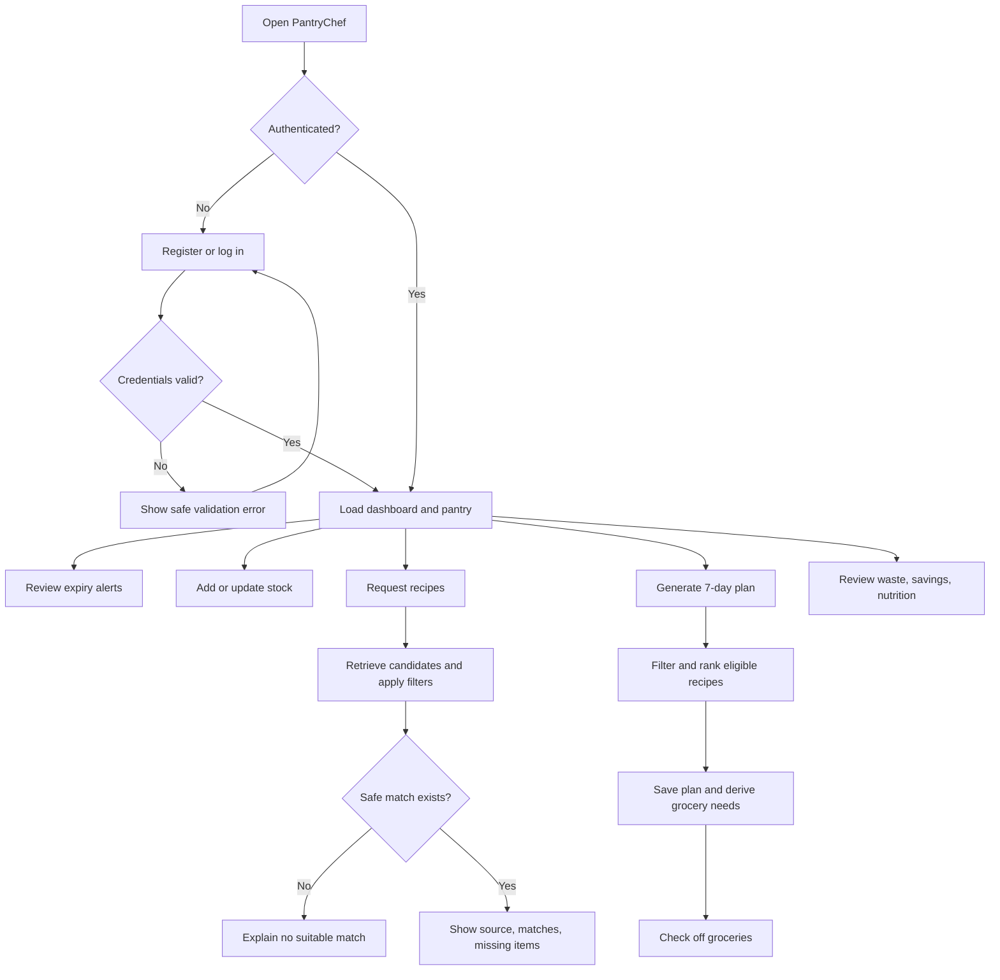
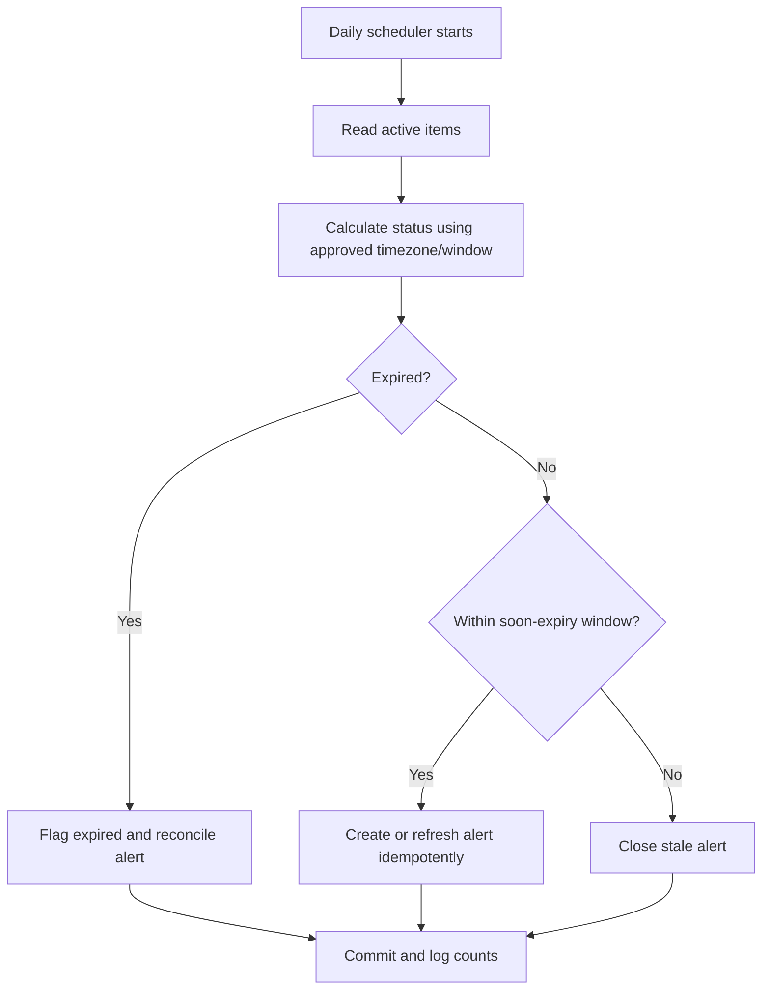
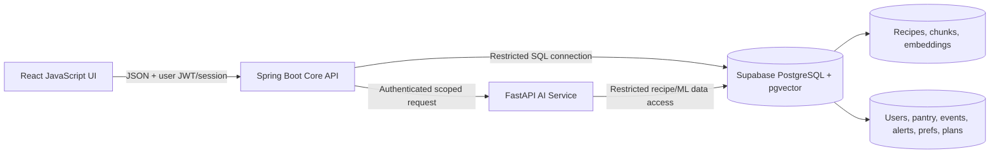
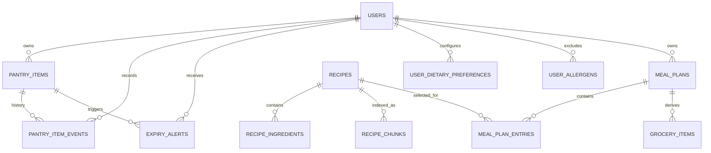
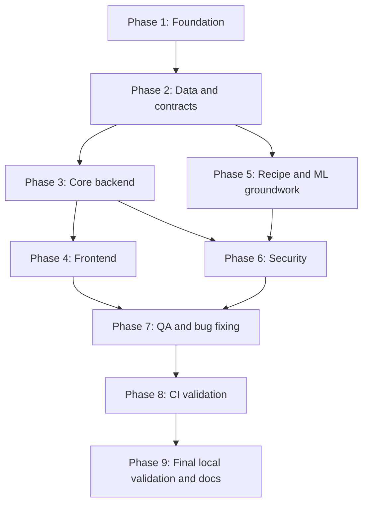

# PantryChef — Complete Project Specification

> **Tagline:** Cook with what you already have. Waste less food, save more money.

## How to read this specification

The supplied `PantryChef.md` describes the intended product, stack, principal features, suggested build order, and exclusions. No application source-code files or repository were supplied, so this document does **not** claim any schema, endpoint, feature, model, or workflow already exists or has passed tests.

- **Confirmed:** stated in the supplied project description or verified against an official source cited below.
- **Proposed:** recommended implementation decision derived from confirmed requirements; review before implementation.
- **Assumption:** working assumption that still needs confirmation.
- **TBD:** information is missing or ambiguous and requires a decision or verification.
- **Out of Scope:** explicitly excluded from the project.

Unless labelled Confirmed, architectural detail, fields, routes, commands, and implementation choices are proposed specifications, not descriptions of an existing codebase. External service quotas and versions can change; recheck official sources before implementation.

---

# 1. Project Overview

## 1.1 Description, problem, and solution

**Confirmed:** PantryChef is a zero-waste meal-planning app. People discard food because they forget expiry dates or do not know what to cook from ingredients at home. PantryChef tracks pantry items and expiry dates, shows in-app alerts, suggests recipes using available ingredients, predicts possible waste, generates a seven-day meal plan and grocery list, and summarizes recorded food-waste savings and planned-meal nutrition.

The intended stack is React with JavaScript (no TypeScript), Spring Boot/Java, FastAPI/Python, Supabase PostgreSQL with `pgvector`, scikit-learn, sentence-transformers, and GitHub Actions. React talks only to Spring Boot; Spring Boot handles normal app logic and calls FastAPI for AI-related operations; both backend services use the shared database.

The proposed user journey is: register/login → record pantry stock → review expiry alerts → retrieve pantry-matched recipes → apply dietary/allergen exclusions → generate a seven-day breakfast/lunch/dinner plan → subtract usable pantry stock from meal ingredients to form a grocery list → review dashboard values derived from recorded events and recipe nutrition data.

The planner must not invent recipe facts, sources, allergens, or nutrition values. If safe recipes cannot fill every slot, show the unavailable slot and its reason rather than fabricate content.

## 1.2 Audience and personas

| Persona | Need | Main workflow |
|---|---|---|
| Household planner | Use ingredients before expiry and plan meals | Pantry, alerts, weekly plan, grocery list |
| Budget-conscious cook | Reduce needless purchases and understand savings | Pantry-first recipes, item events, dashboard |
| Diet/allergy-conscious user | Avoid incompatible recipes | Maintain preferences and receive consistently filtered suggestions/plans |
| Student or small household | Make meal planning less burdensome | Record stock, use suggestions, check grocery items |

These are proposed personas inferred from the product problem, not researched user segments. An admin role, shared household account, or commercial persona is not specified and is not required.

## 1.3 Objectives and measurable success criteria

These are proposed acceptance measures, not claims of current performance.

| Objective | Success measure |
|---|---|
| Inventory reliability | Signed-in user can create, view, edit, use, finish, discard, and remove items; invalid input is rejected |
| Expiry awareness | Daily scan finds items in the approved window, flags expired items, sorts alerts by urgency, and creates no uncontrolled duplicates on retry |
| Recipe usefulness | Suggestion includes source recipe, matched and missing ingredients, and expiry-aware ranking that is covered by tests |
| Safe filtering | Dietary/allergen exclusions apply to recipe suggestions and every plan entry; unknown allergen status is not represented as safe |
| Weekly plan | Generation represents seven days × breakfast/lunch/dinner (up to 21 entries); unfillable slots are explicit |
| Grocery math | Compatible ingredient units are aggregated and reduced by pantry stock; deterministic fixtures prove expected results |
| Trustworthy dashboard | Savings use recorded events and documented formulas; unknown nutrition data is not silently guessed |
| Privacy | Tests prove one user cannot read/change another user's pantry, plans, preferences, alerts, events, or statistics |
| Reproducibility | Frontend, Spring Boot, and FastAPI checks run on push/PR; any required failure fails CI |
| Cost constraint | No core workflow requires a paid API plan, mandatory subscription, paid model, or deployment service |

## 1.4 Scope and exclusions

### In scope

- React JavaScript frontend (not TypeScript by default).
- Spring Boot auth/JWT, authorization, pantry CRUD, lifecycle events, scheduled expiry alerts, dashboard aggregation, and orchestration.
- FastAPI recipe RAG/retrieval, cuisine classification, waste prediction, and meal-plan logic.
- Supabase PostgreSQL + `pgvector`; recipe import, chunking, and idempotent embeddings.
- Dietary filters and allergen exclusions; seven-day plan; grocery list; dashboard charts and nutrition summary.
- Tests, security checks, local setup, CI validation, maintenance, and documentation.

### Explicit exclusions

- **Cloud application deployment, production hosting/URLs, publishing, production releases, infrastructure provisioning, and deployment workflows: OUT OF SCOPE.**
- Native mobile app, barcode scanning, email alerts, and push notifications: **OUT OF SCOPE**. Alerts are in-app only.
- Mandatory paid tools, plans, services, and APIs: **OUT OF SCOPE**.
- Any feature not supported by the source, unless separately approved.

## 1.5 Assumptions, constraints, dependencies

| Type | Item |
|---|---|
| Confirmed | JavaScript + React; Spring Boot; FastAPI; Supabase PostgreSQL + `pgvector`; scikit-learn; sentence-transformers; GitHub Actions |
| Confirmed | Browser calls Spring Boot only; backend services share the database; CI validates pushes/PRs without deployment |
| Proposed assumption | Each registered user owns their pantry, preferences, plans, alerts, events, grocery list, and statistics; no shared-household feature in MVP |
| TBD dependency | Licensed recipe dataset with ingredients, instructions, source attribution, cuisine labels, diet/allergen metadata, and useful nutrition data |
| TBD dependency | Authentic labelled examples for cuisine classification and sufficient valid outcome history for waste prediction |
| TBD dependency | Actual repository layout, database connection mode, Supabase project configuration, exact runtime/dependency versions |
| Limitation | Free tiers have quotas and availability conditions; “free” does not mean unlimited or guaranteed uptime |
| Limitation | Recipe, allergen, nutrition, and ML quality depend on source data and model evaluation |

## 1.6 MVP and future enhancements

The MVP includes all feature groups stated in the supplied source: inventory, expiry alerts, RAG suggestions, both ML tasks, dietary/allergy filtering, weekly plan/grocery list, dashboard, JWT accounts, and CI. Priority marks sequence work, not permission to silently omit a confirmed feature. If an ML feature is blocked by missing data, mark it blocked/TBD and get explicit approval rather than inserting a fake prediction.

Optional future enhancements only: shared household pantry, barcode/receipt/OCR intake, notifications outside the app, mobile app/public deployment, supermarket price integration, advanced personalization, additional models, or LLM-generated prose/conversational cooking. The last item needs a separate decision because no LLM provider is explicitly named in the source.

---

# 2. PRD — Product Requirements Document

## 2.1 Product goals and roles

Goals: record stock accurately; act on expiry risk; cook from available ingredients; build safe and practical plans; avoid unnecessary grocery purchases; show data-backed savings and nutrition; provide a repeatable, free-core, locally runnable development workflow.

| Role | Status | Permissions |
|---|---|---|
| Registered user | Confirmed | Manage only their own pantry, item events, preferences, alerts, plans, grocery items, and stats |
| Unauthenticated visitor | Proposed | Register/login; no private data access |
| Admin/operator | Not specified | No admin UI or elevated role required without new evidence |
| Backend service identity | Proposed | Internal service-to-service work only; not a user identity |

Authorization must be server-side; hiding a button in React is not an authorization control.

## 2.2 Priority definitions

- **P0:** release blocker for safe core behavior, privacy, and required product journey.
- **P1:** required for full MVP, sequenced after foundational components/data readiness.
- **P2:** optional future enhancement, not part of the confirmed MVP.

## 2.3 Functional requirements

| ID | Priority | Requirement | Acceptance criteria |
|---|---|---|---|
| FR-001 | P0 | Register/login with JWT | Valid registration creates one user; duplicate normalized email rejected; login issues expiring auth state; invalid credentials do not disclose sensitive account details |
| FR-002 | P0 | Isolate user data | Every protected request checks identity/ownership; tests with user A's token cannot view or mutate user B's records |
| FR-003 | P0 | Pantry CRUD | Add/list/edit/remove records with name, quantity, unit, price, purchase date, expiry date, and category; invalid values rejected |
| FR-004 | P0 | Categorize items | Supported categories include examples such as dairy, vegetables, and grains; taxonomy and treatment of `other` must be explicit |
| FR-005 | P0 | Record used/finished/discarded events | Quantity/event history stays consistent; no negative remaining quantity; deletion is not treated as use or waste saved |
| FR-006 | P0 | Daily expiry scan | Scheduler evaluates active items against the approved date window and refreshes alert state idempotently |
| FR-007 | P0 | Flag expired items | Expired status follows the approved date/timezone rule; expiry is not treated as proof an item was discarded |
| FR-008 | P0 | In-app expiry alerts | Owner sees alerts sorted by urgency; stale alerts reconcile when stock/status/date changes; no email/push |
| FR-009 | P0 | Pantry-based recipe suggestions | RAG retrieves and ranks candidates; response includes title, source, matched/missing ingredients and ranking data |
| FR-010 | P0 | Recipe citations | Every result maps to a real stored source recipe; import/chunk/embedding process is repeatable and versioned |
| FR-011 | P0 | Dietary filters | Vegan, vegetarian, gluten-free and other approved options apply to every suggestion and plan entry |
| FR-012 | P0 | Allergen exclusions | Exclusions apply during retrieval, planning, and final response; unknown metadata is not represented as safe |
| FR-013 | P1 | Cuisine classifier | FastAPI validates ingredients and uses TF-IDF + Logistic Regression; empty/invalid input gives a controlled response; no unsupported confidence score |
| FR-014 | P1 | Waste-risk predictor | Uses approved days-to-expiry, quantity, category, and usage-history features; needs valid labels/evaluation; insufficient data is explicit |
| FR-015 | P0 | Seven-day plan | Represents 7 days and breakfast/lunch/dinner (up to 21 entries); unavailable slots include a reason rather than fabricated meals |
| FR-016 | P0 | Prioritize near-expiry food | A documented score favors otherwise comparable recipes that use eligible near-expiry stock; tests prove behavior |
| FR-017 | P0 | Generate grocery list | Aggregate meal ingredients minus usable pantry stock when units are compatible; ambiguous conversions remain unresolved and visible |
| FR-018 | P0 | Check off grocery list | Check/uncheck persists and is scoped to the owner's plan |
| FR-019 | P1 | Waste-saved dashboard | Derived from recorded qualifying use-before-expiry events under an approved formula; discarded/deleted items do not count as saved |
| FR-020 | P1 | Money-saved dashboard | Uses documented unit/price formula and currency; missing price data is disclosed, not invented |
| FR-021 | P1 | Nutrition summary | Weekly calories/protein/carbs/fat totals respect servings and source data; missing values are disclosed |
| FR-022 | P1 | Bar/line charts | Labels, readable summary, and empty/partial-data state are available; values match backend calculations |
| FR-023 | P0 | In-app-only alerts | No email, push, or SMS integration |
| FR-024 | P0 | Validate user inputs | Request DTO/schema and DB constraints reject invalid/oversized values; errors are stable and safe |
| FR-025 | P0 | Paid-free tests | Normal CI uses fixtures/mocks and requires neither paid AI usage nor real user credentials |
| FR-026 | P0 | CI triggers | Pushes and pull requests run required frontend/backend/AI checks; failure fails CI; deployment job absent |

### Business rules and edge cases

- **Expiry window TBD:** proposed `expiry_date` between effective local date and three calendar days after it inclusive; earlier is expired. Confirm whether “next 3 days” means this date window or a strict three-day/72-hour interval before implementation.
- **Timezone TBD:** store event timestamps in UTC and use a documented timezone for date comparisons. A single configured application timezone can be the MVP default if per-user zones are unnecessary.
- **Deletion proposed:** removing an item removes it from active inventory but preserves required history; deletion never counts as use/savings.
- **Lifecycle events:** used, finished, and discarded are distinct. A finish action must reconcile the remaining quantity explicitly and consistently.
- **Recipe filters:** apply after retrieval and again before plan persistence/response. No generator/cache/manual fallback may bypass exclusions.
- **Nutrition:** use dataset values or a documented derivation only. Missing values remain unknown; output is not medical advice.
- **ML:** prediction is an estimate, not a guarantee. Never substitute hard-coded fake predictions for missing training data.
- Reject blank names, non-finite/negative quantities, negative prices, invalid dates, unsupported unit/category codes, and unauthorized updates. Use a fixed clock in tests for boundary dates.
- Handle empty recipes, no safe match, insufficient valid recipes, model unavailable, malformed model output, DB/FastAPI outage, duplicate retry, incompatible units, quota exhaustion, and partial nutrition data without false success.

## 2.4 User stories

- **US-001:** As a household planner, I want to register/login so my pantry and plans are private.
- **US-002:** As a cook, I want to record item quantity/unit/price/purchase and expiry dates so I know what is available.
- **US-003:** As a user, I want to mark stock used/finished/discarded so inventory and savings remain truthful.
- **US-004:** As a user, I want urgency-sorted expiry alerts so I can use food in time.
- **US-005:** As a cook, I want pantry-based suggestions that prioritize near-expiry food.
- **US-006:** As a diet/allergy-conscious user, I want every suggestion and plan filtered consistently.
- **US-007:** As a planner, I want a seven-day, three-meal-per-day plan.
- **US-008:** As a shopper, I want a grocery list reduced by pantry stock.
- **US-009:** As a budget-conscious user, I want data-backed waste and money-saved summaries.
- **US-010:** As a user, I want nutrition totals for planned meals when data is available.
- **US-011:** As a user, I want cuisine/waste estimates only when suitable models/data exist.
- **US-012:** As a developer, I want automated validation on every push and PR.

## 2.5 Non-functional requirements

| ID | Priority | Requirement | Acceptance criteria |
|---|---|---|---|
| NFR-001 | P0 | Secure authentication/authorization | Password hashes only, protected routes, owner checks, secret hygiene |
| NFR-002 | P0 | Privacy/data minimization | Collect/store only needed data; logs exclude tokens, credentials, full private payloads and unnecessary allergy detail |
| NFR-003 | P0 | Free-core feasibility | No mandatory paid API, plan, or paid fallback; degrade gracefully at free quota limits |
| NFR-004 | P0 | Local reproducibility | New developer can follow documented install/start/test steps, with explicit external prerequisites |
| NFR-005 | P0 | Predictable failures | Timeouts and dependency failures map to safe errors; no stack trace/secrets in client response |
| NFR-006 | P0 | Maintainability | Clear frontend/core/AI separation, pinned dependencies, tests and documented contracts |
| NFR-007 | P0 | Accessibility | Keyboard access, programmatic labels, readable contrast and status not communicated by color alone |
| NFR-008 | P1 | Responsive usability | Core flows work across suitable desktop/tablet/mobile viewports without fixed style/layout mandates |
| NFR-009 | P1 | Performance | Establish measured local baseline and set thresholds from tests; no invented production SLA |
| NFR-010 | P0 | Data integrity | Non-negative quantity, valid references, owner scoping, transaction/idempotency rules enforced |
| NFR-011 | P0 | Honest test status | Distinguish planned/configured/executed tests; never call an unrun check passed |
| NFR-012 | P0 | CI has no deployment | Only install, static/security checks, tests, and builds; no release/publish/deploy/infrastructure stage |

## 2.6 MVP completion criteria

Complete only when P0 requirements pass, P1 dashboard and ML features are evaluated or explicitly approved as blocked by a documented data dependency, ownership isolation and allergen constraints are tested, recipe/grocery/nutrition/expiry formulas are documented, all three services run locally, CI validates pushes/PRs, and no core function requires paid services. Deployment remains **OUT OF SCOPE**.

---

# 3. User Flows and Application Structure

## 3.1 Main user journey



## 3.2 Inventory flow

1. After login, the server returns only the current user's records.
2. Add/edit uses name, quantity, unit, category, price, purchase date, and optional expiry date.
3. Server-side validation and database constraints run before persistence.
4. Use/finish/discard records an event and updates remaining quantity atomically or by an equivalent consistency-safe operation.
5. Stock balance, expiry state, alerts, and dashboard data refresh from persisted state.

Invalid fields remain editable and show useful feedback. Failed operations do not show success. Concurrent/stale updates and retries must not duplicate usage events.

## 3.3 Expiry-alert flow



The scheduled job must be idempotent. A crash/retry must not create unbounded duplicate alerts. Log job outcomes and failures without passwords, JWTs, or full private payloads. Expiry boundary and timezone are TBD until approved.

## 3.4 Recipe and meal-plan flows

1. React calls Spring Boot only. Spring Boot authenticates the user and derives pantry/preferences from trusted server-side state.
2. Spring Boot calls FastAPI with a scoped, authenticated internal request and bounded timeout.
3. FastAPI normalizes ingredients, retrieves recipe metadata/vector candidates, and ranks results. Every result points to a stored source recipe.
4. Structured diet/allergen rules are applied before a result is returned and again before a plan is persisted. Unknown allergen metadata is not proof of safety.
5. Plan generation returns up to 21 entries across seven days and three meals/day. An unavailable slot is explicit, not fabricated.
6. Grocery requirements aggregate ingredient quantities, normalize compatible units, and subtract usable pantry stock. Incompatible quantities remain unresolved instead of being silently converted.
7. Re-generation behavior, plan start date, default servings, and list-snapshot behavior are TBD. Proposed default: preserve previous plans and provide explicit recalculation rather than silently overwriting user edits.

## 3.5 Authentication/authorization flow

- Registration validates and normalizes email, hashes the password, and stores the user record.
- Login verifies the password hash and returns a signed, expiring JWT/session.
- Protected Spring Boot routes validate signature, expiry, and configured issuer/audience, then derive identity from the validated subject.
- A request-supplied `user_id` never overrides the authenticated identity.
- Spring Boot authenticates internal FastAPI calls through a server-only secret or equivalent mechanism. FastAPI must not expose privileged endpoints to unauthenticated callers.
- Logout clears client/session state; refresh-token, revocation, and session lifetime policy are TBD.

## 3.6 Proposed page inventory

Routes below are provisional. No route inventory was supplied with source code.

| Page | Suggested route | Purpose | Required states |
|---|---|---|---|
| Register/login | `/register`, `/login` | User account access | Empty, submitting, success, validation/auth error, unavailable service |
| Dashboard | `/dashboard` | Expiry, waste, savings, nutrition | Loading, populated, empty, partial data, error |
| Pantry | `/pantry` | Inventory list and actions | Loading, empty, list, validation, success/failure |
| Add/edit item | `/pantry/new`, `/pantry/:id/edit` | Item form | Validation, save, not found/forbidden, error |
| Alerts | `/alerts` | Soon-expiring/expired items | Empty, active, resolved, loading, error |
| Recipes | `/recipes` | Pantry-matched suggestions | Loading, results, no safe match, missing items, error |
| Weekly plan | `/meal-plan` | Generate/view seven-day plan | Generating, complete, partial, no eligible recipes, failure |
| Grocery list | `/grocery-list` | Checkable ingredients | Empty, active, checked, update failure |
| Preferences | `/preferences` | Dietary/allergen settings | Loading, saved, invalid value, failure |

An admin page, public landing page, onboarding tour, or recipe-authoring screen is not required without further evidence.

Navigation rules: unauthenticated requests to private areas redirect to login; APIs still enforce authorization; a 401 clears stale client state and presents a safe login path; a 403 does not reveal whether another user's resource exists; route guards are a UX layer, not a security boundary.

---

# 4. UI/UX Design Document

## 4.1 Design principle

The frontend design, UI/UX, and colour palette must match PantryChef's theme, purpose, functionality, and identity. Choose a consistent, modern, user-friendly experience for food inventory, expiry awareness, recipes, meal planning, and household budgeting. **No specific design style, layout, visual effect, colour value, typography, spacing, shadow, blur, radius, or decorative treatment is mandatory.** Do not introduce such constraints unless separately approved.

## 4.2 Experience goals

- Make urgent pantry items easy to find and act on.
- Keep inventory entry efficient and data validation clear.
- Explain recipe fit through source, matched ingredients, and missing ingredients.
- Make dietary/allergen preferences visible and consistently enforced.
- Keep plans and grocery lists understandable, including partial/unavailable entries.
- Explain how dashboard values are calculated and distinguish recorded facts from ML estimates.
- Preserve readable content, keyboard operation, accessible focus, meaningful status messages, and error feedback that does not rely on colour alone.

## 4.3 Functional interface requirements

| UI area | Behavior |
|---|---|
| Forms | Programmatic labels, required-field cues, specific validation messages, and retained input after a non-destructive error |
| Pantry list | Show item name, remaining quantity/unit, category, expiry date/status and relevant actions |
| Item actions | Keep use/finish/discard distinct; confirm destructive actions when appropriate |
| Expiry urgency | Sort by documented urgency and use text/icon/accessible indicators as well as colour |
| Recipe result | Show source title, matched/missing items, relevant diet labels, and recipe provenance |
| Allergen status | Never represent unknown/incomplete metadata as confirmed safe for a declared exclusion |
| Meal plan | Clearly label date and meal period; show missing slots with reason rather than silently omit them |
| Grocery list | Show quantity/unit and persistent checked state; label unresolved conversions |
| Dashboard | Label charts, provide summaries, and support empty/partial data states |
| Feedback | Loading/saved/failed/empty/disabled/confirmation states where the operation requires them |
| Session | On invalid/expired auth, present predictable login behavior and clear stale private client data |

## 4.4 Screen-specific guidance

- **Authentication:** Explain fields; prevent accidental duplicate submission; use safe errors that do not reveal account existence.
- **Pantry:** Add/edit needs name, quantity, unit, category, price, purchase date and expiry date. No expiry date is distinct from expired. Search/filter/sort/pagination are optional unless needed by data volume.
- **Alerts:** Clearly show soon-expiring and expired items in urgency order. Reconcile stale alert state after stock/date changes. Do not add email/push controls.
- **Recipes:** Each suggestion explains its match without unsupported claims. If no safe match exists, report that fact rather than relaxing allergen filtering.
- **Plan/grocery:** Keep meal slots/quantities identifiable. If conversion is unsupported, show unresolved quantity. Re-generation must not silently erase user modifications.
- **Dashboard:** State that waste/money saved are estimates derived from recorded events. Show missing nutrition data as incomplete; missing chart points must not look like zero unless that is the defined rule.

## 4.5 Accessibility and responsive usability

- Main controls work using keyboard-only navigation and have visible focus indicators.
- Use semantic headings, programmatic form labels, buttons, table/list structure, and suitable status announcements.
- Associate errors with fields/regions and use plain language.
- Ensure readable contrast and do not rely on colour as the sole status indicator.
- Provide chart text labels/summaries or equivalent tabular information where needed.
- Test core workflows at desktop, tablet, and mobile viewport sizes without prescribing a fixed layout/breakpoint.
- Respect reduced-motion settings if animation is introduced; animation is not required.

## 4.6 Design decisions

Stay with React JavaScript. A free React chart library is reasonable, but the source names no library, so **selection is TBD**. Prefer existing or lightweight dependencies and avoid unnecessary UI packages. Design choices must support confirmed functionality, accessibility, and the project theme rather than imposing a popular visual style.

---

# 5. TRD — Technical Requirements Document

## 5.1 Confirmed/recommended stack

| Layer | Technology | Responsibility / status |
|---|---|---|
| Frontend | React + JavaScript, no TypeScript | **Confirmed.** Router, build/test setup and chart library TBD; Vite is only a proposed option if no existing tool constrains the choice. |
| Core backend | Spring Boot + Java | **Confirmed.** Auth/JWT, authorization, pantry CRUD, expiry scheduler, dashboard aggregation, orchestration. Exact framework/runtime/build-tool version TBD. |
| AI service | FastAPI + Python | **Confirmed.** RAG retrieval, cuisine classifier, waste predictor and meal-plan logic. Service auth/model lifecycle proposed below. |
| Database | Supabase PostgreSQL | **Confirmed.** Relational data, events, plans, recipe metadata. Free plan is quota-bound and may pause inactive projects. |
| Vector search | `pgvector` | **Confirmed.** Recipe embeddings stored in PostgreSQL. Official guide: https://supabase.com/docs/guides/database/extensions/pgvector |
| ML | scikit-learn | **Confirmed.** TF-IDF + Logistic Regression for cuisine; Random Forest or Logistic Regression for waste predictor; final predictor chosen from evaluation, not guesswork. |
| Embeddings | sentence-transformers | **Confirmed library family.** Exact model/version/dimension/license/resource profile is TBD pending official model-card review. |
| Communication | JSON over HTTP/HTTPS | React → Spring Boot; Spring Boot → FastAPI. Internal service auth, timeouts and versioning are proposed. |
| CI/CD | GitHub Actions | **Confirmed.** Lint/test/security checks/build on push and pull request; no deployment. |

## 5.2 Architecture



The browser must never connect to PostgreSQL using server credentials or receive DB passwords, Supabase secret/service credentials, JWT signing keys, or the Spring-to-FastAPI secret. Spring Boot is the end-user authentication/authorization authority. FastAPI is internal, not a second public user-permission authority.

The source requires both backend services to use the shared database. Preserve that arrangement but apply least-privilege roles. Prefer passing the minimum normalized ingredient/features needed for an AI request from Spring Boot to FastAPI instead of granting unrestricted access to every user's records. If FastAPI must query user history for prediction, user scope must come from a trusted internal request and be independently enforced. A caller-provided user ID alone is not authorization.

## 5.3 Responsibilities and boundaries

**React:** UI state, navigation, forms, display/accessibility; call Spring Boot only; no privileged business rule enforced only in browser; no secrets; show source information and distinguish recorded data from model estimates.

**Spring Boot:** registration/login/JWT validation; identity/ownership; input validation; inventory events and quantity integrity; daily expiry scheduler; FastAPI calls with timeout and service auth; dashboard formulas/orchestration; defense-in-depth diet/allergen filtering; safe API errors and sanitized logs.

**FastAPI:** internal contracts for retrieval, cuisine, waste prediction and planning; loads versioned embeddings/ML artifacts from trusted paths; uses pgvector and deterministic ranking; returns known source IDs; validates request bounds/service authentication; returns unavailable/insufficient-data state if model/data is missing; never fabricates source/allergen/nutrition facts.

**Database:** relational constraints and event consistency; restricted service credentials; no plaintext passwords, API keys, JWT signing secret or raw access tokens.

## 5.4 Proposed repository structure

No existing layout was provided. This is a proposed monorepo, not a statement about current files. Adapt to existing repository conventions if later supplied.

```text
PantryChef/
├── frontend/src/{api,components,pages,hooks,routes,styles}/
├── frontend/package.json
├── frontend/package-lock.json
├── backend/src/main/java/...       # Spring controllers/services/repos/security
├── backend/src/test/java/...
├── backend/pom.xml                 # Maven option; verify before adopting
├── ai-service/app/{api,schemas,services,ml,db}/
├── ai-service/tests/
├── ai-service/scripts/             # import, embedding, model training
├── ai-service/requirements.txt
├── database/migrations/
├── database/seed/                  # synthetic test fixtures only
├── .github/workflows/ci.yml
├── .gitignore
├── .env.example                    # placeholders only
├── README.md
└── docs/PantryChef_Complete.md     # this specification; final location TBD
```

Do not commit real user data, real `.env`, secrets, large model artifacts, generated embeddings, or large recipe datasets without a reviewed licensing/storage decision.

## 5.5 Service contracts and failure behavior

- React requests go only to Spring Boot. Spring Boot calls FastAPI using minimal required data, request correlation ID, bounded timeout and internal auth.
- FastAPI validates schemas, list/string sizes, ranges/enums and internal authentication before processing.
- The browser cannot control privileged user IDs, table names, model paths, provider settings or SQL fragments.
- Spring Boot maps AI/database failures to safe public errors; no stack trace, SQL, secret or internal host detail reaches the client.
- Inventory mutations/plans need transaction/idempotency protection against duplicate requests/retries.
- Routine calls and long plan/model-startup work may use different timeout budgets; exact values are **TBD** and should be based on local measurements, not presented as an SLA.

## 5.6 Dependency/configuration strategy

Commit lockfiles/pins (`package-lock.json`, Python dependency pins/lock strategy, and Maven wrapper if Maven is chosen). Store secrets in ignored local `.env` or CI secrets. Use placeholders in `.env.example`. Keep separate settings for DB connections, JWT signing, internal service auth, embedding model/path, recipe source, local ports and frontend origin. LLM-provider keys are not mandatory unless LLM generation is later confirmed. Every dependency needs a clear purpose and acceptable license.

## 5.7 Free-tier feasibility and limits

The core MVP must not need a paid tier. Official pages checked on 2026-10-25 show these constraints; re-check before implementation because limits/terms can change.

| Service | Current official detail observed | Consequence | Official source |
|---|---|---|---|
| Supabase Free | Two free projects; 500 MB database/project; 5 GB egress and other quota limits; inactivity pause possible after low activity over 7 days | Keep recipe data/embeddings compact; handle paused/unavailable DB; no automatic paid upgrade | https://supabase.com/docs/guides/platform/billing-on-supabase ; https://supabase.com/docs/guides/platform/free-project-pausing |
| GitHub Actions | GitHub Free lists 2,000 Actions minutes/month and 500 MB storage allowance for applicable Free use; exact runner/billing rules depend on repository/account category | Cache where reliable; avoid long model training or embeddings in routine CI; monitor usage | https://docs.github.com/en/billing/reference/product-usage-included |
| Gemini API | Free-tier access is limited to certain models; model/project-specific RPM/TPM/RPD and data-use terms apply | Not a core requirement. If approved, check exact model and account quota; handle rate limits with graceful fallback | https://ai.google.dev/gemini-api/docs/billing ; https://ai.google.dev/gemini-api/docs/pricing ; https://ai.google.dev/gemini-api/docs/rate-limits |
| Groq API | Free-plan limits are model-specific and vary by request/token/time window/account; 429s are documented | Optional alternative only if an LLM is confirmed; check account limits and honor retry information | https://console.groq.com/docs/rate-limits |
| Local open-source components | Core frameworks/ML can avoid mandatory paid API calls, subject to licenses and local compute resources | Prefer local embeddings and deterministic rules; verify individual package/model/data terms | Check official project docs/model cards once versions are selected |

No paid API may be an automatic fallback. At quota/storage/CI limits, show a clear limitation and keep deterministic functionality available where feasible. Do not enable billing/upgrades automatically.

## 5.8 Runtime versions

The source pins no versions. Proposed baseline for verification:

- **Node.js:** choose supported LTS; Node.js 24 was listed as LTS on the official page on 2026-10-25: https://nodejs.org/en/about/previous-releases.
- **Java:** Java 21 LTS is a proposed baseline, subject to the chosen Spring Boot version. The currently listed Spring Boot 4.1.2 page specifies Java 17+ and Maven 3.6.3+ or supported Gradle versions: https://docs.spring.io/spring-boot/system-requirements.html.
- **Python:** Python 3.13 is a candidate, but verify FastAPI, scikit-learn and sentence-transformers wheel compatibility before locking; current Python lifecycle: https://devguide.python.org/versions/.
- **Database:** confirm Supabase PostgreSQL version, pooler/TLS connection requirements, and pgvector support against the actual project.

Keep versions consistent between local setup, project files and CI. Avoid a new runtime until ML package compatibility is confirmed.

## 5.9 Logging, observability, and trade-offs

Log request ID, operation, duration, status, scheduler counts and sanitized exception category. Never log passwords, JWTs, auth headers, provider/DB secrets, full private requests or unnecessary allergy details. Local console logs are sufficient; paid observability is not required.

- **Shared DB:** simpler but increases impact of over-permissioned credentials; separate roles and test access boundaries.
- **Local embeddings:** avoids a paid embedding API and avoids uploading recipe text, but uses local memory/CPU and needs model/version management.
- **pgvector:** matches confirmed architecture and keeps vectors with recipe metadata; separate vector DB is not warranted at current scope.
- **Deterministic planning:** makes allergy rules and arithmetic testable; an LLM remains optional and cannot override structured constraints.
- **Waste prediction:** requires real labelled outcomes; without data, report unready rather than disguising an arbitrary rule as ML.

---

# 6. Database and Data Design

## 6.1 Database decision and ER diagram

**Confirmed:** Supabase PostgreSQL plus `pgvector`. Relational tables are the source of truth; embeddings are retrieval aids that map back to source recipes. A local PostgreSQL+pgvector alternative may be documented if schema/extension compatibility is tested.



The schema below is **proposed**, not evidence of current tables. Finalize after inspecting an approved recipe dataset and confirming the exact project setup.

## 6.2 Proposed entity/table definitions

### `users`

| Field | Type | Constraint/purpose |
|---|---|---|
| `id` | `uuid` | PK, generated server-side |
| `email` | `text` | Not null; unique after normalization |
| `password_hash` | `text` | Not null; appropriate one-way hash only |
| `created_at`, `updated_at` | `timestamptz` | Not null audit timestamps |
| `disabled_at` | `timestamptz` nullable | Optional; include only if needed |

No plaintext password, raw JWT, provider key, or unnecessary profile fields. Email verification, account recovery and password reset are TBD.

### `pantry_items`

| Field | Type | Constraint/purpose |
|---|---|---|
| `id` | `uuid` | PK |
| `user_id` | `uuid` | FK users, not null, indexed |
| `name` | `text` | Not null; normalized key/display handling documented |
| `category` | `text` | Not null; supported category or explicit `other` |
| `quantity_initial` | `numeric(12,3)` | Not null, positive |
| `quantity_remaining` | `numeric(12,3)` | Not null; `>= 0` and within purchase/adjustment rules |
| `unit` | `text` | Not null; supported unit token |
| `unit_price` | `numeric(12,2)` nullable | Price per defined inventory unit, if approved |
| `currency_code` | `char(3)` nullable | ISO currency code; default TBD |
| `purchase_date` | `date` nullable | Purchase date |
| `expiry_date` | `date` nullable | No expiry date is distinct from expired |
| `status` | `text` | Constrained active/finished/discarded/archived state |
| `created_at`, `updated_at` | `timestamptz` | Not null |
| `deleted_at` | `timestamptz` nullable | Proposed soft deletion; final rule TBD |

The source only says “price,” not whether it is per-unit or total purchase price. `unit_price` is a proposal; confirm before implementation and use a single model consistently in schema and formulas.

### `pantry_item_events`

| Field | Type | Constraint/purpose |
|---|---|---|
| `id` | `uuid` | PK |
| `user_id` | `uuid` | Not null, owner of event |
| `pantry_item_id` | `uuid` | FK item; retention/cascade policy TBD |
| `event_type` | `text` | `used`, `discarded`, `finished`, or approved adjustment |
| `quantity` | `numeric(12,3)` | Positive amount, consistent semantics |
| `unit` | `text` | Compatible with inventory unit |
| `occurred_at` | `timestamptz` | Not null |
| `notes` | `text` nullable | Optional and length-limited |
| `idempotency_key` | `text` nullable | Proposed duplicate-submission prevention |

This history supports the waste dashboard and predictor. A finish action must reconcile remaining quantity rather than create a second unexplained balance.

### `expiry_alerts`

| Field | Type | Constraint/purpose |
|---|---|---|
| `id` | `uuid` | PK |
| `user_id` | `uuid` | Not null owner |
| `pantry_item_id` | `uuid` | FK to item |
| `alert_type` | `text` | `expiring_soon` / `expired` |
| `alert_date` | `date` | Date evaluated |
| `severity` | `text` | Documented urgency level |
| `resolved_at` | `timestamptz` nullable | Set when no longer relevant/actioned |
| `created_at`, `updated_at` | `timestamptz` | Not null |

Choose a uniqueness strategy for one current alert per item/type versus daily history. Proposed default: one current active alert per item/type, refreshed by the daily job.

### `recipes`

| Field | Type | Constraint/purpose |
|---|---|---|
| `id` | `uuid` | PK |
| `source_key`, `source_name` | `text` | Stable source identity; unique where possible |
| `source_url` | `text` nullable | Source URL/attribution, when allowed |
| `source_license` | `text` nullable | Data rights evidence |
| `title`, `instructions` | `text` | Title not null; instructions from permitted source |
| `cuisine` | `text` nullable | Source/training label if available |
| `servings` | `numeric(6,2)` nullable | Positive if provided |
| `calories_per_serving` | `numeric(10,2)` nullable | Only source-backed or documented derived value |
| `protein_g_per_serving`, `carbs_g_per_serving`, `fat_g_per_serving` | `numeric(10,2)` nullable | Source/derivation documented; unknown remains null |
| `nutrition_source` | `text` nullable | Provenance/method |
| `diet_labels` | `text[]` or normalized relation | Only approved/source-backed labels |
| `allergen_metadata_complete` | `boolean` | Explicitly separates reviewed metadata from unknown metadata |
| `created_at`, `updated_at` | `timestamptz` | Audit timestamps |

Dataset license/source is a gating dependency. Do not scrape or redistribute recipes until terms are reviewed. Absent nutrition/allergen fields remain unknown.

### `recipe_ingredients`

| Field | Type | Constraint/purpose |
|---|---|---|
| `id` | `uuid` | PK |
| `recipe_id` | `uuid` | FK recipes, indexed |
| `ingredient_name` | `text` | Not null, display form |
| `normalized_ingredient` | `text` | Canonical search/filter key |
| `quantity` | `numeric(12,3)` nullable | Null if source has no quantity |
| `unit` | `text` nullable | Standard unit if known |
| `allergen_flags` | `text[]` or normalized relation | Structured known indicators with provenance |
| `sort_order` | `integer` | Display order |

Unit conversion needs an approved dictionary; do not assume mass, volume, and count are interchangeable.

### `recipe_chunks`

| Field | Type | Constraint/purpose |
|---|---|---|
| `id` | `uuid` | PK |
| `recipe_id` | `uuid` | FK, not null |
| `chunk_index` | `integer` | Unique per recipe and embedding version |
| `chunk_text` | `text` | Source-derived text, linked to provenance |
| `embedding` | `vector(D)` | `D` must match selected model output dimensions |
| `embedding_model` | `text` | Exact model ID/version |
| `dataset_version` | `text` | Dataset version/checksum |
| `created_at` | `timestamptz` | Not null |

Vector dimension and model remain TBD pending official model-card/license review. Re-index when the model or dataset version changes; do not reuse an incompatible vector/index. Import and embedding jobs must be idempotent.

### `user_dietary_preferences` and `user_allergens`

Proposed normalized tables: `user_id` FK to users, a `preference_code` or `allergen_code` constrained to the approved vocabulary, and `created_at`. Add unique constraints on `(user_id, preference_code)` and `(user_id, allergen_code)`. Vegan, vegetarian and gluten-free are source examples; full taxonomy is TBD.

### `meal_plans`

| Field | Type | Constraint/purpose |
|---|---|---|
| `id` | `uuid` | PK |
| `user_id` | `uuid` | FK to users, owner |
| `start_date`, `end_date` | `date` | Not null; exact seven-day semantics TBD |
| `status` | `text` | `generating`, `complete`, `partial`, or approved state |
| `generation_version` | `text` nullable | Rule/model version |
| `created_at` | `timestamptz` | Not null |

### `meal_plan_entries`

| Field | Type | Constraint/purpose |
|---|---|---|
| `id` | `uuid` | PK |
| `meal_plan_id` | `uuid` | FK plan, not null |
| `recipe_id` | `uuid` nullable | FK recipe; null only for unavailable slot |
| `plan_date` | `date` | Not null, inside plan window |
| `meal_period` | `text` | breakfast/lunch/dinner |
| `servings` | `numeric(6,2)` | Positive; default TBD |
| `slot_status` | `text` | planned/unavailable |
| `unavailable_reason` | `text` nullable | Safe explanation for unfilled slot |

Unique `(meal_plan_id, plan_date, meal_period)` prevents duplicate slots.

### `grocery_items`

| Field | Type | Constraint/purpose |
|---|---|---|
| `id` | `uuid` | PK |
| `meal_plan_id` | `uuid` | FK plan, not null |
| `normalized_ingredient`, `display_name` | `text` | Required canonical/display values |
| `quantity_needed` | `numeric(12,3)` nullable | Remaining quantity if units are convertible |
| `unit` | `text` nullable | Canonical unit if known |
| `quantity_unresolved` | `boolean` | True if safely normalizing/subtracting is not possible |
| `checked` | `boolean` | Not null, default false |
| `checked_at` | `timestamptz` nullable | When checked |

TBD: whether pantry changes auto-recalculate grocery lists. Proposed default: preserve the generation snapshot and provide explicit recalculation so a user's edited list does not change silently.

## 6.3 Keys, constraints, data integrity and ownership

- Primary keys on every table; foreign keys for documented relationships.
- Index `user_id` on user-owned tables and `(user_id, expiry_date)` or equivalent for pantry queries; index alert state and recipe source/normalized ingredient/filter fields.
- Add pgvector indexes only after measuring query behavior and confirming the actual Supabase Postgres version/index support.
- Enforce email uniqueness, non-negative remaining quantity, positive event/serving quantities, valid plan windows, one entry per meal/date, and uniqueness of preferences/allergens.
- Restrict each backend's database role to only necessary operations. If row-level security is used, test it with the real auth architecture; Supabase `auth.uid()` must not be assumed to map automatically to a custom Spring JWT.
- All user-owned joins retain owner scoping. Recipes/embeddings are shared reference data, not user-owned records. FastAPI should not have unrestricted account/password permissions.

## 6.4 Migrations, seeds, retention, backup

- Keep ordered, version-controlled migrations; undocumented dashboard-only edits must not be the sole schema history.
- Test migrations on a fresh disposable database, with uniqueness/foreign-key/check constraints; rerunning setup must recreate schema reliably.
- Recipe import needs source manifest, license record, version/checksum, validation report, stable upsert keys and no duplicate chunks on rerun.
- Use deterministic synthetic fixtures for tests with known ingredients/allergens and deliberate missing-nutrition cases. Synthetic fixtures are not valid evidence of real ML accuracy.
- Do not commit real user data or database dumps. Keep model data separate from test fixtures.
- Account-deletion cascade/retention rules are TBD. Supabase Free is not a substitute for a tested backup/restore process. For local use, schema/fixtures should be recreatable from migrations and seed scripts.

---

# 7. API Contracts and Integrations

## 7.1 API principles and error schema

All routes below are **proposed from the feature list**, not confirmed existing endpoints. Use JSON, explicit validation, stable identifiers, versioned `/api/v1` routes, and consistent errors. React calls Spring Boot only; Spring Boot calls authenticated internal FastAPI endpoints. Use parameterized SQL/JPA, not string-concatenated input.

Proposed error response:

```json
{
  "error": {
    "code": "VALIDATION_ERROR",
    "message": "Check the highlighted fields and try again.",
    "requestId": "correlation-id",
    "fieldErrors": {"quantity": "Must be greater than zero."}
  }
}
```

Do not return stack traces, SQL, raw tokens, prompt contents, private provider responses, filesystem paths or DB connection details. Avoid revealing whether another user's record exists.

## 7.2 Proposed public endpoints

| ID | Method/path | Auth | Purpose and key rules |
|---|---|---|---|
| API-001 | `POST /api/v1/auth/register` | Public | Validate email/password, store password hash; `201`; safe duplicate/invalid errors |
| API-002 | `POST /api/v1/auth/login` | Public | Return expiring JWT/session metadata; generic `401` for invalid credentials |
| API-003 | `POST /api/v1/auth/logout` | Session as designed | Clear client state/revoke server-side session if supported; idempotent |
| API-004 | `GET /api/v1/auth/me` | JWT | Return minimal current-user info; never return password hash or secret |
| API-005 | `GET /api/v1/pantry-items` | JWT | List only caller's items; approved filters/sort/page bounds |
| API-006 | `POST /api/v1/pantry-items` | JWT | Create validated item |
| API-007 | `GET /api/v1/pantry-items/{itemId}` | JWT | Read only owned item; non-disclosing inaccessible response |
| API-008 | `PATCH /api/v1/pantry-items/{itemId}` | JWT | Update owned item; validate stale/concurrent updates |
| API-009 | `DELETE /api/v1/pantry-items/{itemId}` | JWT | Remove from active inventory; proposed soft-delete/history semantics; not a saved-waste event |
| API-010 | `POST /api/v1/pantry-items/{itemId}/events` | JWT | Record use/finish/discard; validate stock, event type and idempotency atomically |
| API-011 | `GET /api/v1/expiry-alerts` | JWT | List only caller's in-app alerts, urgency-sorted |
| API-012 | `POST /api/v1/expiry-alerts/{alertId}/resolve` | JWT | Optional resolution action; does not change stock unless explicitly defined |
| API-013 | `GET /api/v1/recipes/suggestions` | JWT | Spring obtains pantry/preferences and calls FastAPI; result includes source, matches and missing ingredients |
| API-014 | `GET /api/v1/preferences` | JWT | Read caller's preferences |
| API-015 | `PUT /api/v1/preferences` | JWT | Validate and save approved diet/allergen codes |
| API-016 | `POST /api/v1/meal-plans` | JWT | Generate seven-day plan with 21 slots or explicit unavailability; filter before persistence |
| API-017 | `GET /api/v1/meal-plans` | JWT | List caller's plans |
| API-018 | `GET /api/v1/meal-plans/{planId}` | JWT | Read owned plan/entries/grocery list |
| API-019 | `POST /api/v1/meal-plans/{planId}/grocery-recalculation` | JWT | Explicit, idempotent/versioned recalc from defined stock snapshot and unit rules |
| API-020 | `PATCH /api/v1/grocery-items/{itemId}` | JWT | Check/uncheck item only if it belongs to caller's plan |
| API-021 | `GET /api/v1/dashboard/summary` | JWT | User-scoped waste/savings/nutrition plus completeness indicators |
| API-022 | `GET /api/v1/dashboard/nutrition?startDate=...&endDate=...` | JWT | Optional detail series; bounded/validated date range |

Registration verification, password reset, email verification, refresh tokens, MFA and account recovery are TBD; do not describe them as existing. Example item request, for format only:

```json
{
  "name": "Spinach",
  "category": "vegetables",
  "quantity": 2,
  "unit": "bunch",
  "unitPrice": 30.00,
  "currencyCode": "INR",
  "purchaseDate": "2026-10-24",
  "expiryDate": "2026-10-27"
}
```

The example does not establish INR as the system currency. Field optionality, category/unit lists, price basis, and currency default are TBD.

## 7.3 Proposed internal FastAPI endpoints

| ID | Method/path | Caller | Expected behavior |
|---|---|---|---|
| API-AI-001 | `POST /internal/v1/recipes/retrieve` | Authenticated Spring Boot only | Return source IDs, matched/missing ingredients and ranking metadata |
| API-AI-002 | `POST /internal/v1/cuisine/classify` | Authenticated Spring Boot only | TF-IDF + Logistic Regression; valid label; score only if meaningful/calibrated |
| API-AI-003 | `POST /internal/v1/waste/predict` | Authenticated Spring Boot only | Versioned estimate or explicit `insufficient_data`/unavailable result |
| API-AI-004 | `POST /internal/v1/meal-plans/generate` | Authenticated Spring Boot only | Return eligible selected recipe IDs and valid planned/unavailable slots |
| API-AI-005 | `GET /internal/v1/health` | Local/internal | Bounded health/readiness check with no secret/config disclosure |

Illustrative internal payload (not final schema):

```json
{
  "ingredients": [
    {"name": "spinach", "quantity": 2, "unit": "bunch", "daysToExpiry": 1},
    {"name": "rice", "quantity": 1, "unit": "kg", "daysToExpiry": null}
  ],
  "dietPreferences": ["vegetarian"],
  "excludedAllergens": ["peanuts"],
  "limit": 10
}
```

Exact fields/vocabulary are TBD. Do not trust client-supplied `daysToExpiry`, diet, allergy, or user IDs when Spring Boot can derive them from trusted records. Internal service auth must be checked before processing.

## 7.4 Response and status conventions

- Recipe suggestions carry `recipeId`, title, source metadata, matched/missing ingredients, diet labels, and metadata-completeness warnings. The title/source must correspond to a real record; examples are schema illustrations, not real recipe content.
- Waste prediction may return `{ "status": "insufficient_data", "riskLabel": null, "riskScore": null, "modelVersion": null }` where data is not adequate. Exact labels/thresholds remain TBD.
- `200`: successful read/update/calculation; `201`: created; `204`: no body where used consistently; `400`/`422`: invalid input according to one documented policy; `401`: missing/invalid/expired authentication; `403`: authenticated but not permitted; `404`: missing/inaccessible resource per non-disclosure policy; `409`: duplicate/conflict; `429`: app/provider rate limit; `500`: unexpected sanitized server failure; `502`/`503`: dependency unavailable; `504`: downstream timeout.
- Do not return success before a transaction commits. Document `400` vs `422` policy in OpenAPI.
- Validate maximum string/list/request sizes; allowlist sort fields; cap page sizes; bound recipe results and plan-generation work.
- Apply stored preferences even when the client passes empty filter parameters. No request parameter may disable the user's saved allergen exclusion.

## 7.5 Timeouts, rate limits, retries, documentation

Apply bounded timeouts to every downstream call. Retry only idempotent operations or operations protected by an idempotency key, with bounded backoff; respect `Retry-After` where applicable. Do not retry validation/auth errors. A meal-plan or item-event create must be protected from duplicate retries. Use modest rate limits for registration/login, recipe retrieval and expensive plan generation; exact values are TBD. Quota/429 errors map to a safe unavailable response; no paid fallback. Use mocks and deterministic fixtures in CI; live provider calls are not required.

Generate/maintain OpenAPI docs for Spring Boot and FastAPI where supported. Tests cover success, invalid input, missing/expired auth, wrong-owner IDs, duplicate requests, missing source, timeout, unavailable dependencies and filter bypass attempts.

---

# 8. Simple Security Plan

## 8.1 Objectives and verification status

Protect credentials, pantry data, allergy/diet declarations, item history, plans, and statistics. Highest-priority risks are cross-user data exposure, credential/session compromise, SQL injection, allergen-filter bypass, secret leakage, and API abuse/quota exhaustion.

The controls below are planned, not verified. No application source was supplied. A security plan is not proof of secure implementation and cannot promise absolute security.

## 8.2 Authentication and session management

- Hash passwords with a suitable one-way password-hashing function and reviewed configuration; never store plaintext or reversibly encrypted passwords.
- Use generic failed-login messages and conservative rate limiting for brute-force/account-enumeration protection.
- Sign JWTs with a high-entropy secret from an environment variable or approved key-management mechanism. Do not include passwords, pantry history, or allergy details in claims.
- Validate signature, expiry, expected issuer/audience when configured, token type, and user status on protected routes.
- Token lifetime, refresh/revocation, logout semantics and account recovery are **TBD** and must be explicitly documented before implementation.
- If access tokens remain in browser memory, document refresh/re-login behavior. If cookies are used, select `HttpOnly`, `Secure` for HTTPS contexts, and appropriate `SameSite` flags, and add CSRF controls for state-changing requests. Do not mix browser bearer-token and cookie-session assumptions.
- Clear stale user state on logout/401. Frontend guards do not replace backend authorization.

## 8.3 Authorization and least privilege

- Determine user identity from validated auth, never a user ID in request body/query as authority.
- Scope every user-owned query/update by owner; never mutate a record fetched by ID without verifying ownership.
- Give Spring Boot the minimum database permissions required. Use a distinct restricted FastAPI database role and avoid account/password table access where possible.
- Authenticate Spring Boot → FastAPI calls with server-only credentials. Do not send the service secret to React.
- Restrict internal routes explicitly; relying on an obscure local port is not security.
- Test direct-object-reference/cross-user access for pantry items, events, alerts, preferences, plans, grocery items, and dashboard endpoints.

## 8.4 Input validation, injection and browser defenses

- Use parameterized SQL/JPA repository APIs; never concatenate user input into SQL, `ORDER BY`, identifiers, or query fragments.
- Validate bounds, accepted enum codes, list/body size and date/numeric formats. Ingredient normalization must retain a safe display value.
- Render recipe/ingredient text safely; do not insert dataset instructions as trusted HTML. React's normal text rendering should be preferred over dangerous HTML insertion.
- Apply CSRF protection if cookie auth is chosen. For a bearer token outside ambient cookies, document the corresponding CSRF rationale and retain other state-change protections.
- Configure CORS only for intended local frontend origin(s); do not use wildcard origin with credentials.
- Add suitable security headers where relevant to how the frontend is served. File uploads are not part of confirmed scope.

## 8.5 Database, privacy and data retention

- Require TLS/encrypted transport for remote database connections using Supabase's supported connection configuration.
- Store DB credentials, JWT keys and service secrets in local environment variables or restricted CI secrets; never expose them as frontend-public variables.
- Do not give the browser a privileged database credential/key.
- Minimize log detail for allergy preferences and private pantry payloads. Retention and account-deletion policy is TBD before retaining detailed history indefinitely.
- Keep test data synthetic. Do not commit a real person's pantry, grocery or usage history.
- Verify Supabase RLS against the actual auth system. A custom Spring JWT does not automatically populate Supabase Auth's `auth.uid()` context; do not assume an RLS policy applies to JDBC connections without a validated identity design.

## 8.6 Allergen and recipe-data safety

- Treat allergen declarations as high-impact user preferences, although PantryChef is not a medical product.
- Enforce allergen/diet constraints during retrieval, plan selection, persistence, and final API response. Caches, fallback matching and optional generation must not bypass the rules.
- Unknown/incomplete allergen metadata is not equivalent to allergen-free. For a declared exclusion, conservatively mark a recipe ineligible unless the approved metadata policy establishes it is safe to show.
- Use structured ingredients and source metadata, not embedding similarity or generated prose alone, for safety filtering.
- UI should state that source data may be incomplete and PantryChef cannot guarantee medical safety. This warning complements conservative rules; it does not replace them.

## 8.7 Optional LLM, provider and prompt-injection controls

The source confirms RAG and ML but does not make an LLM provider mandatory. If Gemini or Groq is later approved for generated prose:

- Keep provider keys server-side in Spring Boot/FastAPI configuration, never in React or source control.
- Send only minimal necessary context. Do not send email, account IDs, passwords, or full pantry histories when normalized ingredients are enough. Review provider data-use terms before sending personal/allergy data.
- Treat recipe text/retrieved chunks as untrusted data, not instructions. Retrieved content must not invoke tools, change database data, or override system/business policy.
- Require schema-constrained output when generated content feeds UI/planning; validate output and resolve returned recipe IDs against the authoritative database.
- Never rely on an LLM for authorization, allergen safety, source authenticity, or quantity arithmetic; those are deterministic/tested rules.
- Use timeouts, per-user rate limits and graceful quota handling. No paid fallback or automatic billing escalation.
- Core deterministic features must work without an LLM. If a specific optional generated-text feature needs one and none is configured, report it unavailable while preserving other functions.

Official provider documentation shows model/account-specific free limits; Gemini limits include requests/tokens per time window and Groq documents HTTP 429 behavior. Recheck account-visible limits/terms before implementation (Section 5.7).

## 8.8 Secrets, dependencies and logs

- Never commit real `.env`, DB credentials, JWT keys, provider keys, passwords or private keys. `.env.example` uses placeholders only; real `.env` is ignored.
- Rotate credentials immediately if exposed; deleting the most recent line/commit is insufficient if the secret entered history.
- Enable dependency alerts/updates where available. Review licenses of recipe datasets, embedding models and downloaded ML artifacts.
- Pin/constrain versions and scan npm, Python and Java dependencies in CI. Review scanner findings; don't silently suppress them.
- Use minimal GitHub Actions permissions and pin third-party actions to reviewed commit SHAs where practical.
- Client errors contain safe codes/messages/request IDs, not SQL, stack traces, filesystem paths, provider payloads, secrets or private data. Logs should record enough sanitized context for diagnosis without logging full prompts/request bodies or tokens.

## 8.9 Threats, mitigations and residual risk

| Threat | Planned controls | Residual risk / verification |
|---|---|---|
| Cross-user access | Validated identity, scoped queries, least privilege, owner-isolation tests | Every new route/query needs review; RLS integration must match auth mechanism |
| Brute force/credential theft | Password hashing, generic errors, login rate limits, secret hygiene | Recovery/session design TBD; password reuse risk remains |
| SQL injection | Parameterized access, DTO validation, least privilege, tests | New raw queries require review; scanners alone are not enough |
| XSS | Safe rendering/encoding, no trusted recipe HTML, dependency checks | Stored source content still needs contextual tests |
| CSRF/session misuse | Explicit bearer/cookie design, CSRF if cookies | Token lifecycle remains TBD |
| Secret leakage | Ignore files, placeholders, CI secrets, redacted logs, secret scanning | Exposed secrets require immediate rotation/history review |
| Database compromise | TLS, restricted credentials, minimized service access | Misconfiguration and free-tier availability remain risks |
| Allergen bypass | Structured metadata, fail-closed policy, tests at every path | Source metadata can be wrong/incomplete; no medical guarantee |
| Prompt injection if LLM added | Treat retrieved text as data, no tool authority, output schema validation | Model/provider behavior remains probabilistic |
| Abuse/quota exhaustion | Input bounds, rate limits, timeout/idempotency and graceful 429 | Free limits may change or temporarily block calls |
| Dependency vulnerability | Locks, scans, reviewed updates | New disclosures/false positives need human triage |
| False ML confidence | Valid labels, held-out evaluation, version metadata, insufficient-data state | Sparse history and drift remain risks |

## 8.10 Security verification status

All listed controls are **planned/proposed, not implemented or verified** in this document. Tests defined in Section 9 must be run after implementation; do not claim security merely because this plan exists.

---

# 9. Testing and Quality Assurance

## 9.1 QA strategy and status labels

Test functional behavior, ownership boundaries, allergen filtering, quantity/date logic, DB constraints, integrations, and failure states. Use deterministic fixtures and mocks; standard CI must not require paid API requests, real end-user data, or a deployed application.

- **Proposed:** test specified but not run.
- **Configured:** command/workflow exists, but result still needs inspection.
- **Executed:** run in a stated environment with a recorded result.
- **Passed/Failed:** only after actual execution. No tests were executed to create this specification.

## 9.2 Test levels

| Level | Focus | Examples |
|---|---|---|
| Unit | Business logic | Expiry boundary, urgency ordering, quantity/price math, recipe scoring, diet/allergen predicates |
| Database integration | Schema and persistence | Migrations, FK/unique/check constraints, scoped queries, transactions/idempotency |
| API integration | Auth/contracts | Register/login, JWT validation, validation errors, 401/403/404/409, wrong-owner IDs |
| FastAPI | RAG/ML contracts | Fixture retrieval, validation, missing model, malformed outputs, DB unavailable |
| Frontend interaction | Forms and feedback | Error state, loading/success, route protection, grocery check persistence, keyboard access |
| End-to-end | Major journeys | Login → pantry → alerts → recipes → weekly plan → groceries → dashboard |
| Security | Attack boundaries | IDOR, SQL injection inputs, XSS, auth bypass, internal API auth, filter bypass |
| Performance/local stress | Reasonable development scale | Retrieval, plan generation, DB queries and scheduler on a documented fixture size |

## 9.3 Critical tests

All IDs are proposed and should remain stable after automation is added.

| Test ID | Steps | Expected result |
|---|---|---|
| QA-001 | Register valid user and log in | Single user; password only hashed; valid expiring auth issued |
| QA-002 | Register duplicate normalized email; try invalid credentials | No duplicate; safe generic error |
| QA-003 | Create users A/B and call private routes with wrong user's token/IDs | No cross-user reads or mutations; no private record detail disclosed |
| QA-004 | Submit blank name, negative/NaN quantity, negative price, invalid category/date | Stable validation error; no partial write |
| QA-005 | Record partial use then attempt to use more than remaining stock | Stock/event history atomic; excess rejected or explicit approved adjustment; balance never negative |
| QA-006 | Use, discard, and delete items; inspect savings | Only eligible use-before-expiry counts; discarded/deleted stock is not saved food |
| QA-007 | Seed expiry dates around approved boundary; run scheduler twice | Correct state/order; no duplicate alerts on repeated job |
| QA-008 | Test missing expiry, today, boundary, and past date with fixed clock | Correct date/timezone rule; missing expiry is not expired |
| QA-009 | Suggest recipes from known fixture ingredients | Correct source IDs, matched/missing ingredients and near-expiry ranking |
| QA-010 | Seed safe, unsafe, unknown and incomplete allergen records | Incompatible/unknown data never bypasses declared exclusion |
| QA-011 | Generate plan with enough and too few eligible recipes | Seven days/21 slots represented; missing slots labelled; all selected recipes pass filters |
| QA-012 | Test pantry quantities lower/equal/higher than grocery need and incompatible units | Correct arithmetic where compatible; unresolved conversions remain visible; check state persists/owner scoped |
| QA-013 | Calculate savings from known unit prices and event quantities | Result matches approved formula/currency; unknown price not invented |
| QA-014 | Aggregate complete/partial/missing nutrition | Correct serving-based totals and clear incomplete state; chart handles empty/single point |
| QA-015 | Classifier valid, empty, very long and unknown ingredient input | Valid input uses the actual model; invalid/unavailable cases controlled; no fabricated score |
| QA-016 | Waste predictor with valid history, no history, missing feature and mismatched model | Versioned model used only when ready; insufficient data explicit |
| QA-017 | Stop FastAPI/database and issue app request | Bounded timeout, safe unavailable error, sanitized diagnostic log |
| QA-018 | Mock optional LLM quota exhaustion | No paid fallback; deterministic core remains usable; temporary limitation shown |
| QA-019 | Put SQL-like payload in names/search/filter | Treated as data; no query manipulation or unauthorized disclosure |
| QA-020 | Render an XSS test payload in a name/recipe field | Rendered as text/safe content; no script execution |
| QA-021 | Call private API with no/expired/forged/wrong-user token | Correct safe 401/403/404 behavior; no private data |
| QA-022 | Call internal FastAPI route without service auth | Rejected; privileged internal work remains unavailable anonymously |
| QA-023 | Inspect repository, `.gitignore`, and CI logs for secrets | No real secrets; `.env.example` contains placeholders only; `.env` ignored |
| QA-024 | Deliberately fail each required CI check | Workflow fails; no deploy job is triggered or present |
| QA-025 | Apply migrations to empty DB; rerun recipe import | Schema recreated with constraints; no duplicate recipes/chunks/embeddings |
| QA-026 | Run ranking/planner with identical deterministic fixtures | Deterministic rule outputs, except explicitly seeded randomness |

Requirements links: QA-001–002→FR-001; QA-003→FR-002; QA-004–006→FR-003–005/FR-019; QA-007–008→FR-006–008; QA-009–010→FR-009–012; QA-011–012→FR-015–018; QA-013–014→FR-020–022; QA-015–016→FR-013–014; QA-017–018→NFR-005/BR-011; QA-019–023→security controls; QA-024→FR-026/NFR-012; QA-025→database/migration requirements.

## 9.4 Test data and fixtures

- Use small deterministic synthetic fixtures for pantry, recipes, diet labels, allergen states, nutrition completeness and unit conversion boundaries.
- Every authorization suite creates at least two users and separate records.
- Inject a fixed clock for expiry/scheduler tests; never depend on the real current date.
- Mock external HTTP providers in unit/CI tests, including 429, timeout, malformed response and service down cases.
- Keep model train/test data separate from fixtures. Synthetic fixtures test code but cannot substantiate real-world model quality.

## 9.5 ML and retrieval evaluation

**Cuisine classifier:** review data license/provenance; deduplicate; normalize text consistently; split train/validation/test without leakage; begin with TF-IDF + Logistic Regression; report appropriate metrics such as macro-F1 and per-class precision/recall; record data/model/pipeline versions and metrics. Do not state accuracy until a reproducible held-out evaluation has run.

**Waste predictor:** define label and time horizon first (TBD; a potential target is recorded discard by expiry horizon). Prevent data leakage from post-outcome fields. Compare source-proposed Random Forest and Logistic Regression using a leakage-aware split. Record class balance, baseline, precision/recall, calibration where appropriate, and limitations. If history is sparse, return `insufficient_data`.

**RAG:** check top results on representative fixtures, map each result to a known source, compare returned matched/missing ingredients with structured data, prove expiry-priority behavior, test filter bypass attempts, verify model dimensions/normalization/distance metric/index settings, and rerun indexing after controlled dataset/model changes without duplicates.

## 9.6 Proposed commands (align to actual scripts)

Frontend:

```bash
cd frontend
npm ci
npm run lint
npm test -- --run
npm run build
```

If the chosen test runner lacks `--run`, use its CI non-watch command. Package scripts are TBD until the actual manifest exists.

Spring Boot with Maven option:

```bash
cd backend
./mvnw -B verify
```

On Windows use `mvnw.cmd -B verify`. If Gradle is selected, replace this command with its wrapper. FastAPI:

```bash
cd ai-service
python -m venv .venv
python -m pip install --upgrade pip
python -m pip install -r requirements.txt
python -m pytest -q
```

Exact lint/formatter tools are TBD until selected and configured. Do not claim these example commands are already executable.

## 9.7 CI quality gates and Definition of Done

CI must install dependencies from lockfiles, run frontend lint/format, tests where configured and build; run Spring Boot compile/build and tests; install FastAPI dependencies, run pytest, import/compile and configured static checks; run suitable dependency/security scans; and validate schema migrations where feasible. Use mocks/test DBs and no user data. Supabase test credentials, if needed for a separate integration job, must be restricted CI secrets; normal PR CI should not depend on them.

A task is done only when requirements/acceptance criteria and tests are linked; changes are reviewed; normal, boundary, invalid and failure paths have relevant executed tests; changed security boundaries are tested; lint/static checks/tests/build pass locally and in CI; no secrets/unlicensed assets/private data are committed; migrations/API/environment docs/spec are updated; test results and limitations are recorded honestly. **No deployment/release/publication is part of DoD.**

---

---

# 10. Implementation Roadmap

The roadmap translates confirmed requirements into an ordered plan. Tasks marked **Proposed** are implementation recommendations, not claims about the current repository. The actual repository, build files, current code, test coverage, and working-tree state were not provided for inspection; implementation status is therefore **TBD**. This roadmap ends with local validation and CI validation only. **Deployment is OUT OF SCOPE.**

### Phase 1 — Project foundation and repository setup

**Goal:** establish reproducible local development environments and repository conventions before building features.

| Task ID | Priority | Task and dependency | Deliverable | Completion criteria and tests |
|---|---|---|---|---|
| ROAD-001 | P0 | Inspect the actual repository, available source files, licenses, build wrappers, and existing conventions. No prior task dependency. | Inventory of existing modules and gaps. | Existing files and commands are documented accurately; no implementation status is inferred from this specification alone. |
| ROAD-002 | P0 | Confirm supported Java, Node.js, and Python versions against selected framework/ML dependencies. Depends on ROAD-001. | Runtime compatibility record. | Clean installation succeeds in a fresh environment; compatible version pins are recorded. |
| ROAD-003 | P0 | Establish or verify frontend, Spring Boot, and FastAPI module layout; add only required configuration and dependency manifests. Depends on ROAD-001. | Reproducible project foundation. | Each module can install/build locally; existing unrelated files are preserved. |
| ROAD-004 | P0 | Define Git branch and commit conventions and document local environment setup. Depends on ROAD-003. | Developer setup instructions. | A new developer can follow the instructions through the local setup stage without access to production credentials. |

### Phase 2 — Core architecture and data model

**Goal:** create a consistent, user-owned data model and define boundaries before feature-specific implementation.

| Task ID | Priority | Task and dependency | Deliverable | Completion criteria and tests |
|---|---|---|---|---|
| ROAD-005 | P0 | Confirm the database connection strategy and least-privilege access for Spring Boot and FastAPI. Depends on ROAD-002. | Documented database access pattern. | No service-role or elevated database credential is exposed to the browser; intended table privileges are tested. |
| ROAD-006 | P0 | Implement versioned migrations for confirmed tables and constraints. Depends on ROAD-005 and approval of the proposed schema. | Reproducible schema migrations. | Migrations apply to an empty local/test database and integrity tests pass. |
| ROAD-007 | P0 | Finalize API DTOs, internal AI-service request/response contracts, and error envelope. Depends on ROAD-005. | Stable API contract. | OpenAPI/API documentation and tests agree on schemas, ownership and error cases. |
| ROAD-008 | P1 | Prepare small, licensed, deterministic recipe and test fixtures. Depends on a confirmed data source and license. | Versioned fixture set and attribution record. | Fixtures are reproducible, safe for tests, and do not embed private or unlicensed data. |

### Phase 3 — Core backend and application logic

**Goal:** deliver reliable accounts, pantry operations, and expiry behavior before AI-dependent workflows.

| Task ID | Priority | Task and dependency | Deliverable | Completion criteria and tests |
|---|---|---|---|---|
| ROAD-009 | P0 | Implement registration/login and JWT validation with documented expiration and signing-key configuration. Depends on ROAD-006 and ROAD-007. | Authentication endpoints and authorization middleware. | Positive, invalid-token, expired-token and wrong-owner tests pass. Passwords are never stored in plaintext. |
| ROAD-010 | P0 | Implement owner-scoped pantry CRUD, item status transitions and server-side validation. Depends on ROAD-009. | Pantry APIs and service logic. | Cross-account access tests fail safely; quantity, unit and date boundaries are tested. |
| ROAD-011 | P0 | Implement the daily expiry scan and persistent in-app alert generation. Depends on ROAD-010 and schema approval. | Idempotent scheduled task and alerts API. | Boundary tests cover today, three-day cutoff, past expiry, duplicate runs and timezone behavior. |
| ROAD-012 | P1 | Implement auditable item usage/disposal events and deterministic waste-saved/money-saved calculations. Depends on ROAD-010. | Event history and dashboard data services. | Repeated status submissions do not double-count; calculation assumptions are visible and tested. |

### Phase 4 — Frontend implementation

**Goal:** provide the functional user workflows using the confirmed React JavaScript stack and styling that matches PantryChef’s theme.

| Task ID | Priority | Task and dependency | Deliverable | Completion criteria and tests |
|---|---|---|---|---|
| ROAD-013 | P0 | Implement registration/login and authenticated route handling. Depends on ROAD-009 and ROAD-007. | Account UI. | Keyboard-only form use, validation, loading/error feedback, and expired-session behavior are tested. |
| ROAD-014 | P0 | Implement pantry list, item form, edit/delete/status actions, and expiry-alert view. Depends on ROAD-010 and ROAD-011. | Core pantry UI. | UI behavior matches API contracts, handles empty/error states, and does not expose another user’s data. |
| ROAD-015 | P1 | Implement dietary/allergy settings and accessible navigation. Depends on confirmed preference contract. | Preference UI. | Saved preferences persist and are consistently applied by backend/AI workflows. |
| ROAD-016 | P1 | Implement weekly-plan, grocery-list and dashboard screens after their API contracts are stable. Depends on ROAD-018 and ROAD-021 below. | Planning and dashboard UI. | Loading, empty, error, check-off and calculation states have interaction tests. |

### Phase 5 — Integrations and AI functionality

**Goal:** add deterministic-first recipe retrieval and ML capabilities without making paid model access a core dependency.

| Task ID | Priority | Task and dependency | Deliverable | Completion criteria and tests |
|---|---|---|---|---|
| ROAD-017 | P0 | Build the licensed recipe ingestion, normalization, chunking, embedding and indexing pipeline. Depends on ROAD-008 and ROAD-006. | Re-runnable recipe indexing process. | Re-indexing is deterministic/idempotent; embedding dimensions and license metadata are validated. |
| ROAD-018 | P0 | Implement recipe retrieval and source citations, expiry-aware ranking, matched/missing ingredient calculation, and dietary/allergy filtering. Depends on ROAD-017 and ROAD-015. | Recipe retrieval endpoint. | Tests verify citations, ingredient matching, allergy exclusion and empty-result behavior; hard safety filters run after retrieval too. |
| ROAD-019 | P1 | Train and evaluate the cuisine classifier using an approved, labeled dataset. Depends on dataset decision and ROAD-017 where applicable. | Reproducible model-training/evaluation artifact. | Metrics and class distribution are recorded; low-confidence/unknown inputs are handled; model is compared with a simple baseline. |
| ROAD-020 | P1 | Train and evaluate waste-prediction model if enough legitimate usage history exists. Depends on approved data and ROAD-012. | Versioned model or explicit rule-based baseline. | Leakage, class imbalance and calibration are assessed; no fabricated histories are used. If data are insufficient, retain baseline and document TBD. |
| ROAD-021 | P1 | Implement 7-day meal-plan generation, nutrition aggregation and grocery-list subtraction from pantry stock. Depends on ROAD-018 and nutrition-data decision. | Plan/grocery APIs. | Dietary/allergen exclusions are enforced; inventory subtraction, duplicate ingredients, units, and plan regeneration are tested. |
| ROAD-022 | P1 | Integrate the dashboard metrics and chart data from the backend. Depends on ROAD-012 and ROAD-021. | Dashboard APIs and UI data. | Displayed totals match deterministic fixtures and explain their calculation window. |

**LLM decision:** the source confirms RAG and ML, but does not require Gemini or Groq as the generation provider. PantryChef’s mandatory MVP should not depend on a paid LLM. First establish recipe retrieval and structured plan selection; if natural-language generation is later approved, treat Gemini/Groq as optional, provider-isolated adapters with current model/region/quota verification, mock-based CI tests and deterministic fallback. Never introduce vector search beyond the already specified pgvector recipe retrieval.

### Phase 6 — Security implementation

| Task ID | Priority | Task and dependency | Deliverable | Completion criteria and tests |
|---|---|---|---|---|
| ROAD-023 | P0 | Harden auth, owner-scoped access, token expiry, credential configuration and secret separation. Depends on ROAD-009 and ROAD-010. | Verified baseline access controls. | Unauthorized and cross-user test cases pass; no secrets are committed. |
| ROAD-024 | P0 | Validate/encode inputs, configure safe errors, CORS, request limits, database permissions, and dependency checks. Depends on ROAD-007. | Security configuration and tests. | Injection, invalid payload, unauthorized-origin where applicable, and oversized-request cases return safe results. |
| ROAD-025 | P0 | Apply allergy filters consistently to retrieval and plan-generation paths; review data provenance and model output handling. Depends on ROAD-018 and ROAD-021. | Defense-in-depth filtering. | Test fixtures containing excluded allergens never appear as selectable recommendations; limitations are disclosed. |

### Phase 7 — Testing and bug fixing

| Task ID | Priority | Task and dependency | Deliverable | Completion criteria and tests |
|---|---|---|---|---|
| ROAD-026 | P0 | Implement unit and integration tests for core flows and persistence. Depends on Phases 2–6 for the relevant module. | Automated regression suite. | Critical requirements have traceable tests and all required local commands work. |
| ROAD-027 | P0 | Add cross-account, validation, scheduler-boundary, allergen, RAG citation, and failure-injection tests. Depends on ROAD-026. | Negative/security test coverage. | Expected failures are tested, not merely happy paths. |
| ROAD-028 | P1 | Add frontend end-to-end coverage for registration, inventory, alerts, plans and grocery check-off. Depends on stable APIs and ROAD-026. | Repeatable major-journey tests. | Major workflows pass against deterministic local/test dependencies. |
| ROAD-029 | P1 | Measure key local workflows and query/index behavior; optimize only evidence-backed bottlenecks. Depends on ROAD-026. | Lightweight performance baseline. | Any discovered regression is documented; no unsupported SLA is asserted. |

### Phase 8 — CI/CD validation pipeline

| Task ID | Priority | Task and dependency | Deliverable | Completion criteria and tests |
|---|---|---|---|---|
| ROAD-030 | P0 | Add separate frontend, Spring Boot and FastAPI validation jobs to GitHub Actions for pushes and pull requests. Depends on all module manifests and ROAD-026. | CI workflow files. | Workflow syntax is valid; each job runs appropriate install, checks, tests and builds. |
| ROAD-031 | P0 | Configure caching, deterministic fixtures, secret-safe logs, and dependency/security checks. Depends on ROAD-030. | Reliable, safe CI execution. | No paid external API or production credential is required; failed required jobs produce a failed check. |
| ROAD-032 | P0 | Verify successful and failing CI runs using a real repository workflow once repository access is available. Depends on ROAD-031. | Evidence of CI validation. | Actual run URLs/results are recorded by a maintainer; specification alone is not treated as proof of passing. |

### Phase 9 — Final local validation and documentation review

| Task ID | Priority | Task and dependency | Deliverable | Completion criteria and tests |
|---|---|---|---|---|
| ROAD-033 | P0 | Follow setup instructions in a clean local environment and run all module checks. Depends on Phases 1–8. | Reproducible local validation record. | Frontend, backend and AI service start locally; tests and builds complete as recorded, without requiring deployment. |
| ROAD-034 | P0 | Review requirements-to-tests traceability, privacy, licensing, known limitations, environment examples, and this specification against the actual implementation. Depends on ROAD-033. | Updated specification and release-readiness checklist. | Unimplemented items and TBD decisions remain visible; no fabricated verification is claimed. |

### Dependency overview



No phase includes hosting, cloud deployment, a production release, publishing, or public availability. **Deployment is OUT OF SCOPE.**

---

# 11. Local Development, CI/CD, and Project Maintenance

### 11.1 Local development prerequisites

The versions below are a proposed baseline to verify against the selected library versions and actual build files before implementation. They do not claim that a repository already pins them.

| Tool | Proposed baseline | Purpose / verification |
|---|---|---|
| Git | Current supported release | Version control and review. |
| Node.js + npm | Node.js 24 LTS and compatible npm | React JavaScript frontend; confirm any build tool compatibility. |
| Java | Java 17 or later supported by selected Spring Boot line | Spring Boot runtime. Pin one version in local/CI configuration after checking the selected Spring Boot release. |
| Maven | Maven 3.6.3+ if using the cited Spring Boot baseline | Build and test Spring Boot. Prefer a checked-in Maven Wrapper if consistent with the repository. |
| Python | Python 3.13 proposed | FastAPI, scikit-learn, sentence-transformers; verify exact compatibility of all ML dependencies before pinning. |
| PostgreSQL/Supabase | Supported PostgreSQL version with `pgvector` extension | Persistent app data and vector similarity search. Local PostgreSQL can be used for repeatable tests if its schema/extensions match. |
| Browser | Current supported Chrome/Firefox/Edge | Frontend manual/automated validation. |

Reference URLs for version-sensitive details are listed in Section 12. Tool and dependency versions must be pinned for reproducible CI after compatibility is confirmed.

### 11.2 Configuration and environment variables

Use local `.env` files or the supported per-service environment configuration and keep them untracked. Add only placeholder examples to the repository. Do not overwrite a developer’s existing `.env` file without explicit consent. Provide a `.env.example` or equivalent template only after confirming the actual configuration loader; it must contain no working credentials.

Illustrative template (names and requirements are **Proposed/TBD** until aligned with the implemented configuration):

```dotenv
# React: public application configuration only; never put secrets here.
VITE_API_BASE_URL=http://localhost:8080/api

# Spring Boot database and auth configuration.
SPRING_DATASOURCE_URL=jdbc:postgresql://localhost:5432/pantrychef
SPRING_DATASOURCE_USERNAME=REPLACE_WITH_LOCAL_DB_USER
SPRING_DATASOURCE_PASSWORD=REPLACE_WITH_LOCAL_DB_PASSWORD
JWT_SIGNING_SECRET=REPLACE_WITH_HIGH_ENTROPY_LOCAL_SECRET
JWT_ISSUER=pantrychef-local

# Spring Boot -> FastAPI internal service configuration.
FASTAPI_BASE_URL=http://localhost:8000
SERVICE_TO_SERVICE_SECRET=REPLACE_WITH_LOCAL_ONLY_SECRET

# FastAPI data/model settings; confirm names with actual settings code.
DATABASE_URL=REPLACE_WITH_TEST_DATABASE_URL
RECIPE_DATA_PATH=./data/recipes
EMBEDDING_MODEL_ID=REPLACE_WITH_APPROVED_MODEL_ID
```

Guidance:

- This example is not a final binding contract; align names and required/optional status with actual settings classes. Do not set conflicting database variables in both services without documenting which service reads them.
- `VITE_*` values are generally shipped to browser code; they must never contain database passwords, JWT signing keys, service-to-service secrets, or private AI keys.
- Prefer a separate least-privilege database role per service if feasible. If both services share a database, document which tables each may read/write and avoid letting FastAPI bypass Spring Boot user authorization by accepting arbitrary user IDs.
- Do not commit a real `.env`, a local database dump containing personal data, service key, or model credential. Keep local secrets out of logs and error output.
- If hosted Supabase is used for development, its credentials and quotas remain subject to its current plan. A local database avoids CI network dependencies but must include the required `pgvector` extension to test vector behavior.
- AI provider keys are not required for deterministic unit tests. If a provider is approved for optional interactive development, keep its private key on the FastAPI trusted side only and omit it from CI unless an explicitly authorized, separately budgeted integration test needs it.

### 11.3 Proposed local startup and validation commands

Exact commands depend on the repository wrappers/manifests. Treat these as expected commands to implement or reconcile, not as proof that the current project already provides them.

| Module | Expected command examples | Notes |
|---|---|---|
| Frontend | `npm ci`; `npm run lint`; `npm test -- --run`; `npm run build`; `npm run dev` | Ensure corresponding scripts exist in `package.json`. If using another test runner, document the equivalent deterministic command rather than forcing the example. |
| Spring Boot | `./mvnw -B verify` (Windows: `mvnw.cmd -B verify`); local run via `./mvnw spring-boot:run` if configured | Prefer checked-in Maven Wrapper. Ensure tests use isolated/test DB settings and never a personal database. |
| FastAPI | `python -m venv .venv`; activate environment; `python -m pip install -r requirements.txt`; `python -m pytest`; local run with `uvicorn <configured_module>:app --reload` | Replace `<configured_module>` with the actual module path. Add lint/type-check tools only after selecting and pinning them. |
| Database | Apply versioned migrations using the selected migration process; use seeded test fixtures | The database and required vector extension must match schema assumptions. Never run tests against valuable personal data. |

Example development sequence after configuration and test data exist: start the database; start FastAPI; start Spring Boot; start the React development server. The frontend should only need the Spring Boot API base URL. The exact ports and module paths are Proposed and must be reconciled with the actual project.

### 11.4 Troubleshooting guide

| Symptom | Likely cause | Safe troubleshooting action |
|---|---|---|
| Browser API requests fail | Incorrect API base URL, CORS mismatch, or backend not running | Check local environment values, browser network console, and Spring Boot logs; never loosen CORS globally as a quick fix. |
| Spring Boot cannot connect to PostgreSQL | Invalid connection string, unavailable database, missing schema, or credentials | Verify local database status and migrations; use a test account and redact credentials from logs. |
| pgvector query or migration fails | Extension absent, incompatible version, or embedding dimension mismatch | Verify extension availability and migration settings; ensure model output dimension matches the schema before indexing. |
| FastAPI cannot load model/data | Missing dependency, incompatible Python version, absent model cache, or missing licensed dataset | Confirm pinned runtime/dependency versions and documented data download/local path; do not substitute unlicensed or fake data silently. |
| CI succeeds locally but fails on GitHub | Runtime mismatch, missing fixture, case-sensitive path, unpinned dependency, or hidden secret dependency | Reproduce on clean environment; make tests deterministic and remove dependency on local files or personal credentials. |
| Test quota is exhausted | Tests unexpectedly call an external provider or hosted service | Replace that test boundary with a mock/fixture; keep provider smoke tests optional and separate from required CI. |
| Duplicate expiry alerts or savings | Scheduler not idempotent or repeated state transition | Test reruns, use database constraints/transactions, and record the event before deriving aggregates. |
| Recipe source/citation missing | Ingestion metadata lost or result not linked to a source record | Fail safe: do not present an unsupported source; repair ingestion and citation-contract tests. |

### 11.5 Git and change conventions

**Proposed:** use short-lived descriptive branches, pull requests for review, and imperative commits with a scoped prefix such as `feat: add pantry CRUD`, `fix: prevent duplicate expiry alerts`, `test: cover allergy exclusions`, `docs: update local setup`, and `ci: validate FastAPI tests`. Follow existing repository conventions if they exist. Avoid committing generated model weights, raw licensed datasets, build outputs, virtual environments, `.env` files, and personal data. Use migrations for schema changes and include appropriate tests in the same change.

A change affecting behavior should update the relevant requirement/test references and, where necessary, the API contract, schema description, environment instructions, and user-facing limitations. Never rewrite collaborators’ unrelated changes or overwrite a developer’s local configuration as part of setup automation.

### 11.6 CI provider and workflow requirements

**Confirmed:** GitHub Actions is the source-specified CI provider. The required outcome is automatic validation on every push and pull request. **Deployment is OUT OF SCOPE.**

#### Triggers and job topology

- Trigger on `push` and `pull_request` for maintained branches; choose branch filters only after confirming the actual branch model.
- Run separate frontend, Spring Boot, and FastAPI jobs so each module’s failure is visible. A final validation summary may depend on all required jobs.
- Pin supported runtime versions and install dependencies from lockfiles/wrappers or equivalent reproducible manifests.
- Cache npm, Maven, and pip downloads where supported and keyed to dependency-lock/configuration files. Caching must not be used to hide unresolved dependency problems.
- No job may deploy, publish, upload production assets, provision infrastructure, create a production release, or require production credentials.

#### Required job stages

| Job | Stages | Required success criteria |
|---|---|---|
| Frontend | Checkout; setup pinned Node; dependency install (`npm ci` where lockfile supports it); formatting check if configured; lint; component/unit tests; production-mode build verification | Every required command exits successfully; no required check is silently skipped. |
| Spring Boot | Checkout; setup pinned JDK; use Maven/Gradle wrapper; compile/build; unit and integration tests with isolated test configuration; dependency vulnerability check | Build/test/security stages finish successfully; tests do not require a personal database or production service. |
| FastAPI | Checkout; setup pinned Python; install from pinned requirements/lockfile; lint/type checks if selected; pytest with deterministic fixtures; dependency vulnerability check | Tests pass without live LLM calls, account-specific credentials or paid APIs. |
| Validation summary (optional) | Depend on all mandatory validation jobs and clearly report their status | Green only when every mandatory job succeeds. |

Potential security tooling includes native dependency review/advisory checks, `npm audit`, `pip-audit`, and a Java dependency scanner compatible with the build. Confirm tools’ versions, false-positive handling, and actual free access before adoption. Do not configure blanket “ignore all vulnerabilities” rules; record and justify each accepted exception, its owner, risk and expiry. Some tools and GitHub security features may depend on repository visibility or account settings.

#### Environment and external dependencies

- Use test-only databases/fixtures and random test users. For PostgreSQL/pgvector integration tests, either launch an isolated compatible database or use a controlled test Supabase project only if its credentials, quota, and network needs are explicitly understood. Never run mutating tests against a user’s real data.
- Mock the internal FastAPI boundary when testing Spring Boot behavior that does not depend on the AI service. Test FastAPI retrieval and ML functions with deterministic fixtures. LLM provider calls, if later approved, must be mocked in the required suite.
- Add CI secrets only when a justified integration test actually needs them; store them in repository/environment secrets, limit access to trusted contexts, avoid exposing them to untrusted pull-request code, and never echo them.
- Forked pull requests may not receive repository secrets. Required CI should still run without real provider keys. Treat a skipped optional external integration as “not run”, not as passing proof of integration correctness.
- `pull_request` code is untrusted. Do not use privileged triggers or expose write tokens/secrets to untrusted code just to simplify a workflow.

#### Failure behavior and free-tier constraints

A required nonzero exit status, dependency-install error, failed test, failed build, or failed security gate must make the corresponding CI check fail. Pull requests must not be considered validated when a required job is pending, skipped unexpectedly, or failing. Fix the cause or document a reviewed, narrow exception; do not mask errors with `|| true` or continue-on-error on mandatory checks.

GitHub's official included-usage documentation has listed a 2,000 Actions minutes/month allowance for GitHub Free and storage limits, with exact usage depending on repository visibility, runner type, account and current policy. Verify the current account/repository allowance before relying on it. Keep CI quick with independent jobs, caching, path filters only when safe, and no unnecessary matrix expansion. A free allowance is a quota, not a guarantee of unlimited service.

**CI acceptance checklist:**

- [ ] Push triggers validation.
- [ ] Pull request triggers validation.
- [ ] Frontend lint/test/build checks run.
- [ ] Spring Boot build/tests run.
- [ ] FastAPI tests run with deterministic fixtures.
- [ ] Dependency/security checks run or explicitly document their access/tooling TBDs.
- [ ] Required CI does not depend on live paid API calls or production secrets.
- [ ] Failure in any required stage marks the workflow failed.
- [ ] A maintainer has verified actual successful and deliberately failing runs; link/run IDs are recorded only after execution.
- [ ] No deployment, release, publish, production hosting or infrastructure-provisioning job exists.

### 11.7 Free-tier and no-paid-core rule

The mandatory project workflow must be usable with locally runnable open-source components and free-tier services where an external service is necessary. Supabase Free has documented resource limits, including 500 MB database storage per project, and free projects can be paused after a period of inactivity; these facts can affect demos and CI. The selected embedding model may run locally but still consumes local memory, disk and CPU/GPU resources. No LLM provider is required by the source specification. If an optional provider integration is added, verify model-specific limits, terms and regional availability immediately before use and expose a graceful quota/provider-unavailable state. Do not require paid fallback services.

### 11.8 Maintenance and keeping the spec synchronized

- Review direct and transitive dependency advisories at a regular cadence and when material releases occur; prioritize security fixes while preserving a reproducible lockfile.
- Upgrade frameworks/models deliberately, validate compatibility, re-run critical regression tests, and record migration notes.
- Maintain recipe data provenance, license/attribution metadata, schema versions, model training inputs, feature definitions, evaluation metrics, model artifacts and model-version compatibility.
- Avoid commiting model files or datasets until size, licensing, and repository constraints have been assessed. Provide a documented local acquisition/build process where appropriate.
- For each feature/API/schema/security change, update IDs, acceptance criteria, tests, diagrams, setup examples, known risks, and change history in this one specification. Remove obsolete descriptions only after verifying the actual implementation and callers.
- Record test results as execution evidence, including date, commands, environment, and relevant CI run link. The documentation itself is not evidence that code or tests pass.
- Revisit free-tier quotas, SDK/framework runtime requirements, data licenses, and provider/model support before each material release of the local project.

**Deployment is OUT OF SCOPE.** The project completion target is a locally runnable application with a tested implementation and functioning CI validation on pushes and pull requests—not a hosted or publicly available product.

---

---

# 12. Risks, Open Questions, and Change History

### 12.1 Risk register

The risks below are plausible consequences of the specified architecture and features, not claims that these failures have already occurred. Likelihood and impact are initial qualitative assessments and should be updated with evidence during implementation.

| Risk ID | Risk and classification | Initial likelihood / impact | Mitigation and validation | Residual risk / owner |
|---|---|---|---|---|
| RISK-001 | Recipe dataset licensing, attribution, redistribution or commercial-use terms may not permit intended use. Legal/data | Medium / High | Choose a dataset with clear terms; retain origin, license and attribution metadata; exclude data whose rights cannot be confirmed. | Rights interpretation may remain unclear. Owner: project maintainer; source/license decision is TBD. |
| RISK-002 | Allergens may be missing, ambiguous, or mislabeled in a recipe source. Safety/privacy | Medium / High | Apply user-configured exclusions both before and after retrieval/plan generation; preserve unknown ingredient status; do not represent outputs as medically safe; manually validate fixtures. | Data errors cannot be eliminated by code alone. Owner: product/data maintainer. |
| RISK-003 | Expiry dates or usage records may be incomplete or inaccurate. Product/data | High / Medium | Validate date ranges, let users correct item records, label estimates clearly, and test timezone/boundary behavior. | Results are only as accurate as the entered data. |
| RISK-004 | “Waste saved” and “money saved” may be overstated through duplicate events or unclear valuation. Product/data | Medium / High | Use idempotent usage events, specify calculation rules, avoid counting thrown-away items as saved, and test duplicate status transitions. | Price is not necessarily the amount saved; calculation definitions need product approval. |
| RISK-005 | Too little legitimate training data leads to unreliable or biased ML predictions. ML | High / Medium | Establish simple baselines, use held-out evaluation, report limitations, and avoid training/testing on synthetic histories as if real. | Predictive capability may remain limited until usage history exists. |
| RISK-006 | Embedding model and stored vector dimensions are incompatible or change across indexing runs. Technical | Medium / Medium | Pin the embedding model/version and dimension; persist index metadata; require re-indexing migrations for changes; test mismatch handling. | Model artifacts and local-resource availability remain operational constraints. |
| RISK-007 | Hosted Supabase free-tier limits, inactivity pausing, or regional availability disrupt development/demo. External service | Medium / Medium | Have a local PostgreSQL/pgvector option, document reset/restart procedures, monitor quotas manually, and avoid mandatory dependence on a paid plan. | Hosted availability and quotas remain provider-controlled. |
| RISK-008 | GitHub Actions included minutes/storage are consumed by repeat CI runs. CI/cost | Low–Medium / Medium | Cache dependencies, avoid unnecessary matrices, use local deterministic tests, and check current account allowance. | Free allowance/eligibility can change. |
| RISK-009 | Shared DB access allows the AI service to bypass owner-scoped application boundaries. Security | Medium / High | Define service database roles/privileges and service-to-service trust; pass authenticated context through a verified internal interface; never trust arbitrary client-supplied user IDs. | A shared database increases the impact of credential compromise. |
| RISK-010 | JWT keys are weak, leaked, or changed without a rotation/expiry strategy. Security | Medium / High | Use high-entropy secret configuration, short-lived access tokens as decided, safe expiration, no browser storage of signing keys, and a documented rotation procedure. | Token theft remains possible on compromised devices. |
| RISK-011 | RAG returns recipe snippets that omit allergen context or cite an incorrect source. Safety/data | Medium / High | Keep ingredient/source metadata with every recipe, validate citations, apply allergy filters to final candidates, and omit unsupported source claims. | Incomplete source records can still mislead. |
| RISK-012 | LLM/provider use, if introduced, exhausts a free quota or changes its terms/model availability. External service/cost | Medium / Medium | Keep provider optional; mock calls in CI; handle rate limits/timeouts; use deterministic retrieval/planning fallback; recheck official terms. | Optional AI generation can be temporarily unavailable. |
| RISK-013 | Nutrition values are inaccurate because ingredients, serving sizes, brands, or cooking methods differ. Product/data | High / Medium | Use an approved nutrition source, preserve units and serving basis, document missing data and estimation method, and test aggregation. | Nutrition remains an estimate unless data provenance and portions are reliable. |
| RISK-014 | Recipe or plan generation creates inconsistent ingredient units or quantities. Product/technical | Medium / Medium | Normalize supported units, keep unknown units explicit, prevent unsafe arithmetic across incompatible units, and test recipe scaling/grocery subtraction. | Some ingredients cannot be safely normalized automatically. |
| RISK-015 | CI uses hidden developer-specific settings or secrets and is not reproducible. CI | Medium / Medium | Pin versions, use safe fixtures, test from clean environments, and keep mandatory CI free of provider secrets. | External runners and dependency registries can still have transient failures. |
| RISK-016 | Project scope grows through optional AI providers, excessive model infrastructure, or unverified features. Project/maintainability | Medium / Medium | Enforce MVP priorities and the stated technology boundaries; require evidence and a written change decision for additions. | New requirements may change costs and complexity. |
| RISK-017 | Personal pantry history or dietary/allergy preferences leak through logs or cross-account queries. Privacy/security | Medium / High | Minimize logged content, redact identifiers and payloads, scope every query by verified owner, restrict access and test cross-account paths. | A system compromise or operator misconfiguration remains possible. |
| RISK-018 | Model quality is presented as certainty even when inputs are sparse or out of distribution. ML/product | Medium / Medium | Measure a baseline, expose uncertainty/unknown outcomes where useful, document intended use, and avoid deterministic promises about food waste. | Accuracy may vary by user, cuisine and data quality. |

### 12.2 Open questions and decisions requiring verification

Each `TBD` below is a real unresolved decision based on the current source material. A decision owner should resolve it before the dependent feature is considered complete. These entries are not silently treated as confirmed architecture.

| TBD ID | Question / missing evidence | Why it matters and affected sections | Proposed next action / owner |
|---|---|---|---|
| TBD-001 | What exact recipe dataset will be used, and what license/attribution terms apply? | RAG legality, source citations, indexing and repository size; Sections 5–8, 10–12. | Select and review a suitable source and preserve attribution metadata. Owner: project maintainer. |
| TBD-002 | What are the actual repository structure, package manifests, branch conventions, and current implemented features? | Prevents inaccurate code-status claims and unnecessary rewrites; Sections 5, 10–11. | Inspect the repository before creating or changing files. Owner: developer. |
| TBD-003 | Which exact Spring Boot, Maven/Gradle, Node/npm, Python, FastAPI, scikit-learn, and sentence-transformers versions are compatible? | Runtime pinning and CI reproducibility; Sections 5 and 11. | Verify current official requirements and the selected dependency matrix. Owner: developer. |
| TBD-004 | Will Spring Boot and FastAPI use separate least-privilege database roles, or a constrained shared database role? | Shared-database security and user isolation; Sections 5, 6 and 8. | Review table access requirements and choose least privilege before implementation. Owner: backend developer. |
| TBD-005 | Will the database run locally for development/CI, or will a hosted Supabase project also be used? | Quotas, test isolation, pgvector support and credentials; Sections 5, 6 and 11. | Prefer local deterministic integration tests; document any hosted setup separately. Owner: developer. |
| TBD-006 | What are the final schema field types, quantity precision, units, and accepted category values? | Accurate inventory, plan scaling and grocery subtraction; Sections 6–7. | Approve field constraints and unit conventions before migrations. Owner: backend/product. |
| TBD-007 | Is email verification, password recovery, refresh-token rotation, or logout/revocation required? | Auth lifecycle and account UX are not fully specified by the source; Sections 2, 3, 7–8. | Choose MVP auth lifecycle and test cases explicitly. Owner: product/backend. |
| TBD-008 | What JWT claims, access-token lifetime, signing algorithm and rotation procedure will be used? | Token validation, revocation and operational security; Section 8. | Define from current library support and threat needs; do not hardcode secrets. Owner: backend/security reviewer. |
| TBD-009 | What timezone defines the daily expiry scan and “next 3 days” cutoff? | Alert correctness near midnight and daylight-saving transitions; Sections 2, 6, 7, 9. | Store a clear date/time policy and test date boundaries. Owner: product/backend. |
| TBD-010 | What does “expired items flagged automatically” mean in the actual item lifecycle—flag only, or change status? | Avoid deleting or misclassifying inventory; Sections 2, 6–7. | Prefer a separate expiry flag/calculated state until an explicit behavior is approved. Owner: product. |
| TBD-011 | What exact business rules define waste saved, money saved, and eligible “rescued” events? | Dashboard accuracy and avoiding duplicate claims; Sections 2, 6–7, 9. | Document event definitions, calculation window, item valuation and exclusions. Owner: product. |
| TBD-012 | Which recipe source fields and ingredient taxonomy are available? | Ingredient matching, citations, allergy filters and cuisine classifier labels; Sections 5–9. | Inspect the licensed dataset and map only fields supported by evidence. Owner: data/AI developer. |
| TBD-013 | Which embedding model and dimension are approved, and what local resources does it need? | pgvector schema and resource use; Sections 5–6 and 10. | Benchmark a suitable local model and pin model ID/version and dimensions. Owner: AI developer. |
| TBD-014 | Does the required MVP need a generative LLM, or can retrieval plus deterministic planning satisfy it? | Avoids unnecessary API/provider dependency and cost; Sections 1, 5, 7, 10. | Start with source-required RAG/ML; decide on LLM only with a user-visible product need. Owner: product/AI developer. |
| TBD-015 | If an LLM is approved, which provider/model is available in the user’s region/account at the time of implementation? | Model availability, quotas, privacy and provider terms; Sections 5, 7–9. | Compare official Gemini and Groq docs at decision time; keep provider optional and swappable. Owner: AI developer. |
| TBD-016 | What labeled cuisine dataset and class taxonomy are allowed for the TF-IDF + Logistic Regression classifier? | Training validity, licensing and expected label behavior; Sections 5, 9–10. | Select an approved dataset, record provenance, split by source/recipe to reduce leakage, and evaluate a baseline. Owner: AI developer. |
| TBD-017 | What labeled usage history exists for waste prediction, and how are “wasted” outcomes recorded? | Determines whether a supervised model is viable; Sections 5–6, 9–10. | Audit available data. If insufficient, document the limitation and keep a transparent rule-based baseline. Owner: data/product. |
| TBD-018 | Which nutrition source, serving-size model, and unit conversions are acceptable? | Nutrition summaries cannot be accurate without provenance; Sections 2, 6–7 and 9. | Choose a suitable dataset/source and document missing-value behavior. Owner: product/data. |
| TBD-019 | What is the canonical dietary taxonomy and how are recipes with unknown dietary attributes handled? | Consistency and safe filtering; Sections 2, 6–8. | Define allow/deny/unknown behavior and test each filter at retrieval and planning time. Owner: product. |
| TBD-020 | What is the allergen taxonomy, cross-contamination policy, and source-data completeness threshold? | High-impact dietary safety; Sections 2, 7–9. | Decide conservative behavior for unknown data and clearly communicate limitations. Owner: product/safety reviewer. |
| TBD-021 | Which exact frontend test, lint and formatting tools are already selected? | Avoids assuming scripts exist; Sections 9–11. | Inspect package manifests, retain working tooling and add missing checks only when justified. Owner: frontend developer. |
| TBD-022 | Which exact Java dependency vulnerability scanner can run in the intended GitHub Actions configuration? | Security CI may differ by repo visibility and tool access; Section 11. | Verify licensing/account access and pin the selected scanner. Owner: CI maintainer. |
| TBD-023 | What GitHub repository visibility, plan, concurrency and current included Actions minutes apply? | CI usage assumptions may be wrong for a specific account; Section 11. | Check the repository’s current billing and usage pages. Owner: repository admin. |
| TBD-024 | Are nutrition values, recipe data, and pantry logs retained indefinitely, and can users delete/export them? | Privacy, retention and lifecycle obligations; Sections 2, 6, 8. | Decide retention, account deletion, event retention and export behavior before launch readiness. Owner: product/privacy reviewer. |
| TBD-025 | Is the meal plan intended to be deterministic and reproducible across regeneration, or allowed to vary? | Testability, user trust and debugging; Sections 2, 7, 9. | Define seed/selection policy or document nondeterministic choices. Owner: product/AI. |
| TBD-026 | How should the UI behave when the recipe index, embedding model, ML model, or FastAPI service is unavailable? | Controls degradation and user-facing error behavior; Sections 2–5, 7, 9. | Set feature-specific fallback/error contracts and test each failure mode. Owner: architecture/backend. |
| TBD-027 | What numerical acceptance thresholds are appropriate for cuisine/waste model evaluation? | A model cannot be declared useful without objective criteria; Sections 2 and 9. | Establish baselines and thresholds after dataset exploration; do not invent metrics before evidence. Owner: AI/product. |
| TBD-028 | Which chart library and accessibility expectations fit the current React version? | Dashboard implementation and dependency scope; Sections 4–5 and 11. | Inspect existing dependencies first, then choose a compatible free option only if needed. Owner: frontend developer. |
| TBD-029 | How should users correct quantity, purchase/expiry dates, unit mismatches, and accidentally recorded disposal? | Data quality and savings calculations; Sections 2, 6–7. | Approve edit/history behavior and define whether events can be reversed or corrected. Owner: product/backend. |
| TBD-030 | What local environment operating systems and hardware are officially supported? | Model/resource expectations and developer onboarding; Sections 5 and 11. | State a minimum supported local setup after measuring the embedding/ML workflow. Owner: maintainer. |

### 12.3 Known limitations

The following limitations follow from the current requirements or are unavoidable until key data/implementation decisions are made:

- No existing source code, build manifests, database migrations, test results, or CI runs were included in the supplied source file. Existing implementation completeness and runtime behavior cannot be verified from that file alone.
- Recipe quality, nutrition, cuisine labels and allergen safety depend on the selected dataset and the quality of its metadata. The system must not imply that recommendations are medically safe or that all allergen data are complete.
- Waste and money saved depend on accurate pantry quantities, price data, and item-use/disposal events. The metrics should be described as calculated estimates under a documented rule, not independent proof of avoided waste.
- The waste predictor needs suitable labeled historical outcomes. Until an adequate dataset exists, its performance and readiness are unknown; a simple baseline may be preferable.
- A local embedding/model workflow may need meaningful disk, CPU, memory or optional GPU resources. Hardware requirements must be measured rather than invented.
- Free-tier service quotas, account eligibility, supported models, data terms, and plan limits may change. Current values must be rechecked at implementation time.
- The source specifies in-app alerts only. Email, push notifications, mobile applications, barcode scanning and cloud deployment are excluded from this specification's MVP scope.
- Deployment is **OUT OF SCOPE**. This document does not assert that PantryChef is implemented, secure, deployed, publicly reachable, or passing tests.

### 12.4 Verification sources for version-sensitive details

The following are official documentation pages consulted as reference points on **2026-10-25**. They are external references, not project attachments. Quotas, plan eligibility, version support and terms can change; revisit them before selecting versions/services and before implementation. If the exact applicable account/model is not verifiable from a public page, treat it as TBD.

| Topic | Official source | How it informs this specification |
|---|---|---|
| Supabase plans, quotas and included resources | https://supabase.com/docs/guides/platform/billing-on-supabase | Establishes that the Free plan has finite database/storage/egress and usage limits. The documented 500 MB database allowance per project is a planning constraint, not unlimited capacity. |
| Supabase free-project pausing | https://supabase.com/docs/guides/platform/free-project-pausing | Documents inactivity-related pausing for free projects; account/project behavior should be checked before demos. |
| Supabase `pgvector` | https://supabase.com/docs/guides/database/extensions/pgvector | Reference for enabling and using vector similarity search in PostgreSQL. Confirm embedding dimensions and extension compatibility for the chosen schema. |
| GitHub Actions included usage | https://docs.github.com/en/billing/reference/product-usage-included | Official usage allowances and limits; the commonly documented GitHub Free allowance of 2,000 minutes/month is not a guarantee for every repository/runner scenario. Confirm the actual account/repository allowance. |
| Gemini API billing and free access | https://ai.google.dev/gemini-api/docs/billing | Provider billing model and free-tier distinctions; does not establish that a specific PantryChef call/model is available forever or in every region. |
| Gemini API pricing | https://ai.google.dev/gemini-api/docs/pricing | Current model-specific pricing/reference, to recheck if an optional provider is evaluated. |
| Gemini API rate limits | https://ai.google.dev/gemini-api/docs/rate-limits | Model/account-dependent quotas and request limits; handle quota errors and verify access when configuring. |
| Groq API rate limits | https://console.groq.com/docs/rate-limits | Model/account-dependent usage limits; do not assume a global or unlimited free quota. |
| Spring Boot system requirements | https://docs.spring.io/spring-boot/system-requirements.html | Version-sensitive JDK and build-tool compatibility. Select runtime based on the actual chosen Spring Boot release. |
| Node.js release status | https://nodejs.org/en/about/previous-releases | Reference for current Node release/LTS status; pin a compatible version for the actual frontend toolchain. |
| Python supported versions | https://devguide.python.org/versions/ | Reference for Python lifecycle; ML library compatibility must also be checked before pinning. |


### 12.5 Final documentation completeness checklist

This checklist evaluates the specification document, not application implementation. A check mark means that the documentation section is present and reviewed at the specification level; it does not assert that code, controls, tests or workflows have been implemented or passed.

#### Required section structure

- [x] **Section 1 — Project Overview:** purpose, goals, scope, assumptions, constraints, MVP and optional enhancements documented.
- [x] **Section 2 — PRD:** feature requirements, priorities, user stories, non-functional requirements and acceptance criteria documented.
- [x] **Section 3 — User Flows and Application Structure:** core user journeys, application page inventory and flow diagram documented.
- [x] **Section 4 — UI/UX Design Document:** theme-led, functional and accessible guidance documented without a mandated visual style.
- [x] **Section 5 — TRD:** technology roles, system architecture, local structure, trade-offs and service limits documented.
- [x] **Section 6 — Database and Data Design:** proposed entities, relationships, constraints and migration/data strategy documented; final schema remains subject to TBD decisions.
- [x] **Section 7 — API Contracts and Integrations:** proposed endpoint contracts, validation, error handling and external integration boundaries documented; actual implementation remains unverified.
- [x] **Section 8 — Simple Security Plan:** applicable threats, mitigations, security tests, secret handling and residual risks documented.
- [x] **Section 9 — Testing and Quality Assurance:** test IDs, negative scenarios, local commands, CI expectations and Definition of Done documented.
- [x] **Section 10 — Implementation Roadmap:** nine ordered phases with task IDs, dependencies, priorities, deliverables and completion criteria documented.
- [x] **Section 11 — Local Development, CI/CD, and Project Maintenance:** prerequisites, placeholder environment template, local commands, troubleshooting, CI stages, free-tier constraints and maintenance documented.
- [x] **Section 12 — Risks, Open Questions, and Change History:** risk register, TBD decisions, limitations, sources, metadata and change history documented.
- [x] Final completeness checklist included within this same file.

#### Decisions and external details that remain open

- [ ] Resolve material product/data/architecture issues in `TBD-001` through `TBD-030` as relevant to the approved MVP; not every optional decision must block foundational local setup, but dependent features must not be called complete while their critical TBD remains unresolved.
- [ ] Review the actual repository/source code and existing build manifests before treating proposed structure, API paths, dependencies, or configuration names as final.
- [ ] Verify exact runtime and dependency versions against official documentation and lock them for the implementation.
- [ ] Confirm recipe dataset licensing, nutrition provenance, ML labels/training data, allergen completeness, and any attribution obligations.
- [ ] Validate current Supabase, GitHub Actions, and any optional AI-provider quotas and eligibility against the actual account, selected model and region.
- [ ] Record evidence from real local test/build runs and CI workflow runs only after execution; this specification does not claim those checks have passed.
- [ ] Confirm that CI validates push and pull-request changes and that no deployment/release/publishing/infrastructure job has been introduced.

**Final implementation outcome:** a locally runnable PantryChef application with tested core functionality and an automatic CI validation pipeline for pushes and pull requests. Core functionality must not require paid services. Public hosting, cloud deployment, production release, automatic publishing and infrastructure provisioning are **OUT OF SCOPE**.
